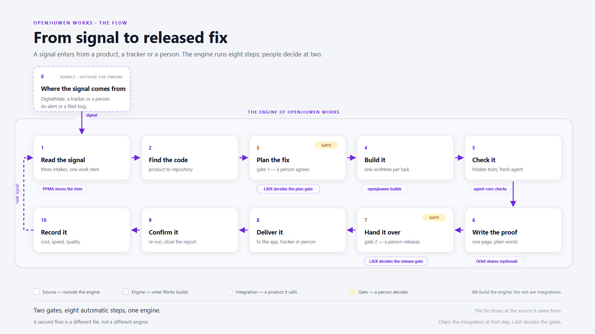

<div align="center">
  <picture>
    <source media="(prefers-color-scheme: dark)" srcset="docs/ui/banner-dark.svg" />
    
  </picture>
</div>

# openJiuwen Works

**A local-first software factory.** A report goes in. A reproduced, checked and proven fix comes out —
with people making the two decisions that matter.

[](https://github.com/michaelatamuk/openjiuwen-works/actions/workflows/ci.yml)
[](LICENSE)

> A coding agent usually stops at a diff. Works carries the change through proof, review and release.

<div align="center">
  
</div>

## Why it exists

Writing a fix is rarely the slow part. Most of the time goes to understanding the report, agreeing on
a plan, reviewing the change and proving that it is safe.

Works takes that work and keeps it on your machine. It does not ask you to trust a summary: it shows
the change, the checks and the evidence, and it stops where a person should decide.

## What it does

- **Reproduces before fixing.** The failing behaviour is shown on the current code first.
- **Plans the change and the checks.** You see what will change and what will judge it.
- **Builds and checks in a disposable copy.** Your working tree is never the experiment.
- **Writes the proof.** One page tied to the exact change: what ran, what passed, what cost, what was
  not covered.
- **Delivers and confirms.** A change request and one comment on the original report; then the real
  result is checked again.

## Two decisions stay with people

- **The plan.** You approve the checks that will judge the change. An AI agent cannot approve them.
- **The release.** You approve the exact commit and its proof. Delivery waits for that decision.

Everything between the two decisions is automatic and recorded.

## How it works

| Phase | What happens | Who |
|---|---|---|
| **Understand** | A report arrives from a person, a tracker or a monitor. Works reproduces the problem on the current code. | Works |
| **Agree** | Works drafts a plan and the checks. You approve, change or reject it. | **you** |
| **Change** | Works builds in a disposable copy and runs the approved checks. | Works |
| **Prove** | The evidence page is written and tied to the exact change. | Works |
| **Release** | You approve the proof. Works delivers the change and confirms the real result. | **you**, then Works |

<div align="center">
  
</div>

Nothing moves on silently. If a check fails or a proof no longer matches, the task waits for a person.

## When several things are ready

One queue, one job per project. Works shows why each task is waiting: a free slot, your decision, the
day's budget or the machine being busy.

<div align="center">
  
</div>

The queue is optional and off by default. It never approves a plan or a release, and a started run is
allowed to finish.

## Try it

The demo is local, deterministic and needs no model or network:

```bash
uv sync --extra dev
python scripts/demo-ui.py
# open the path the script prints
uv run works --home /path/printed/by/demo ui
```

That opens the app at `http://127.0.0.1:8765/` with five example tasks, including one waiting at the
release gate.

## Use it on your project

```bash
uv sync --extra server --extra providers
uv run works daemon start --write
```

Open `http://127.0.0.1:8765/` and:

1. **Import** a ticket from GitHub, Jira or a monitor, or **create** one.
2. Let Works reproduce it and draft a plan.
3. **Approve the plan**, then let Works build, check and write the proof.
4. **Approve the release**, deliver the change and confirm the result.

A provider key is needed for the live builder. The deterministic trace mode runs without a model; see
[`docs/guides/live-harness.md`](docs/guides/live-harness.md).

The CLI follows the same two decisions; `works --help` lists the commands.

## Built for one machine

Works is deliberately local: one daemon, one home (`~/.works`), no accounts and no hosted service.
The two gates are always human, one project runs one job at a time, and delivery ends at a change
request — merge, deploy and close remain your decisions.

## Documentation

- [`docs/guides/how-a-fix-flows.md`](docs/guides/how-a-fix-flows.md) — the flow in plain words.
- [`docs/guides/runbook.md`](docs/guides/runbook.md) — what to do when something goes wrong.
- [`docs/reference/proof.md`](docs/reference/proof.md) — what the proof contains.
- [`docs/guides/intake.md`](docs/guides/intake.md) — trackers, monitors and your products.
- [`docs/guides/remote.md`](docs/guides/remote.md) — another device without exposing the port.
- [`docs/deck/`](docs/deck/) — slides and diagrams.

## License

Apache-2.0. See [`LICENSE`](LICENSE).
