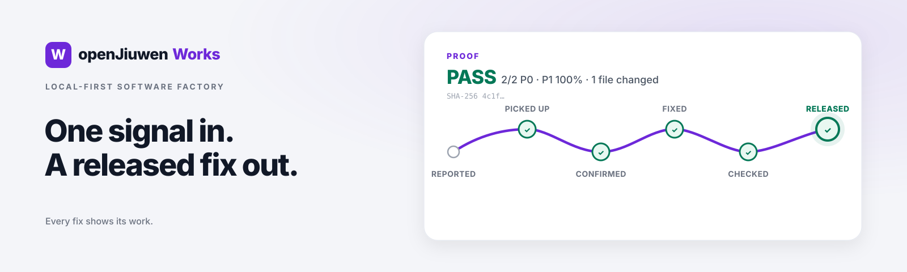
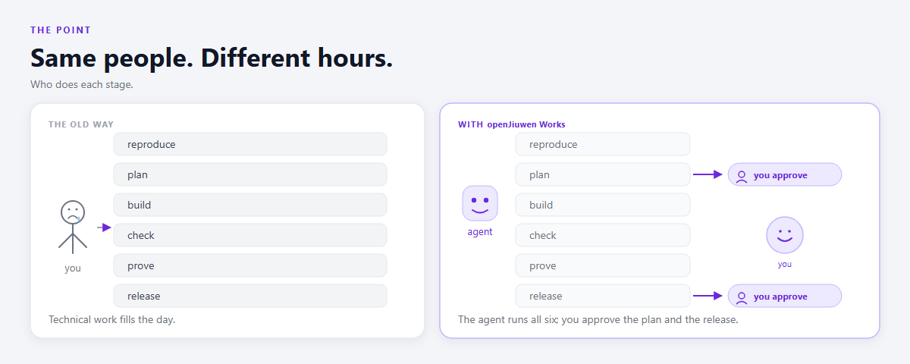
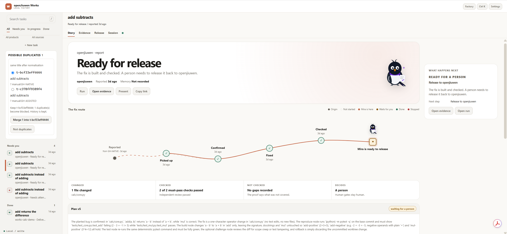
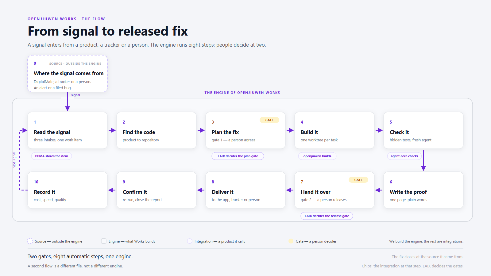
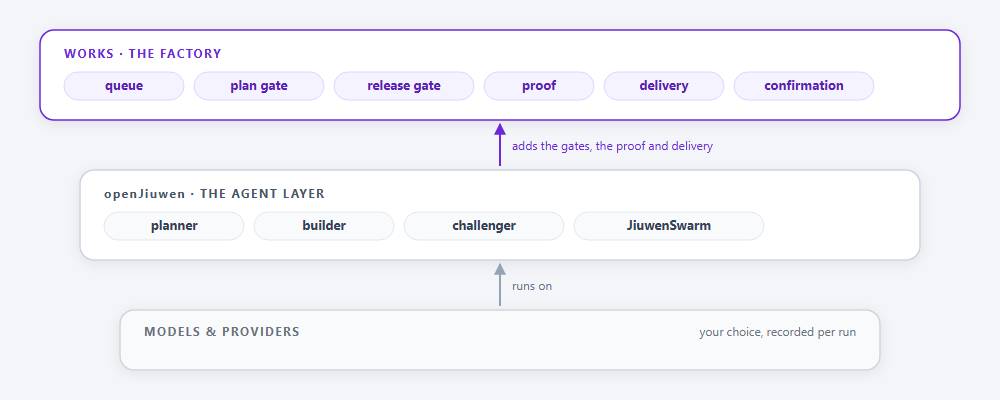
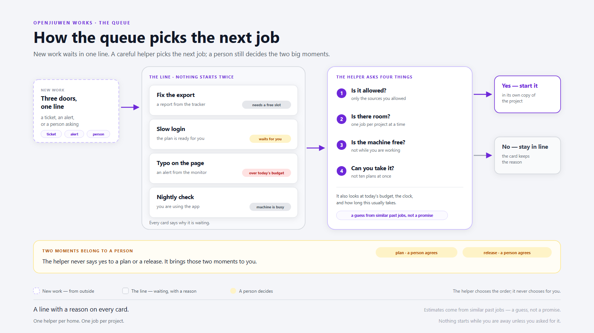

<div align="center">
  <picture>
    <source media="(prefers-color-scheme: dark)" srcset="docs/assets/ui/banner-dark.svg" />
    
  </picture>
</div>

# openJiuwen Works

**A local-first software factory for anyone responsible for shipping software, where the bottleneck is
verifying changes, not writing them.** A report arrives from a tracker, a monitor or a person. Works
reproduces the failure on the current code, plans the change and the checks that will judge it, builds
in a disposable copy and writes proof tied to the exact commit. People make the two decisions that
matter — approve the plan and approve the release — and Works delivers the change and confirms the real
result.

[](https://github.com/michaelatamuk/openjiuwen-works/actions/workflows/ci.yml)
[](pyproject.toml)
[](#built-for-one-machine)
[](LICENSE)

<sub>v0.0.1 · pre-release</sub>

> Works carries a change through proof, review and release.

## The point

The technical work an agent can do should not consume a person's day. Reproduction, builds, checks,
proofs, delivery and confirmation run on their own; people keep the decisions that need judgement — the
plan and the release — and spend their time on the problems that actually need them. The result is a
team whose hours go to judgement and design.

<div align="center">
  
</div>

## What it does

- **Reproduces the problem on the current code** before anything changes, so the work starts from a
  failure that actually exists.
- **Plans the change and the checks that will judge it**, so the bar is agreed before the build starts.
- **Builds in a disposable copy**, leaving your working tree untouched.
- **Writes the proof**: one page bound to the exact change — what ran, what passed, what it cost, what
  it risked and what was not covered.
- **Delivers and confirms**: a change request, one comment on the original report, then a fresh check
  of the real result.

**The difference is the binding.** The proof is tied to the exact commit and re-verified at release;
the checks are read from the base commit, so a change cannot rewrite the tests that judge it.

## One screen, the whole task

<div align="center">
  
</div>

The report, the route, the checks and the next step are in one place; the proof is one click away.
[Watch the 45-second film](docs/assets/openjiuwen-works-two-mondays.mp4).

## Two decisions stay with people

- **The plan.** A person approves the checks that will judge the change.
- **The release.** A person approves the exact commit and its proof. Delivery waits for that decision.

Everything between the two decisions is automatic and recorded.

## How it works

| Phase | What happens | Who |
|---|---|---|
| **Understand** | A report arrives from a person, a tracker or a monitor. Works reproduces the problem on the current code. | Works |
| **Agree** | Works drafts a plan and the checks. A person approves, changes or rejects it. | **you** |
| **Change** | Works builds in a disposable copy and runs the approved checks. | Works |
| **Prove** | The evidence page is written and tied to the exact change. | Works |
| **Release** | A person approves the proof. Works delivers the change and confirms the real result. | **you**, then Works |

<div align="center">
  
</div>

Every phase is recorded. A failed check or a mismatched proof returns the task to a person.

## Built on openJiuwen

The name is deliberate: Works is the factory around **openJiuwen**. The planner, builder and challenger
are openJiuwen harnesses, and JiuwenSwarm can run as an isolated builder. Works adds the queue, the two
human gates, the proof, delivery and confirmation. The agent layer is openJiuwen; the model and provider
are your choice, and every run records the runtime, model and provider.

<div align="center">
  
</div>

## When there is more than one thing to do

One queue, one job per project. Works shows why each task is waiting: a free slot, your decision, the
day's budget or the machine being busy.

<div align="center">
  
</div>

The queue is optional and off by default. The plan and release decisions remain with people, and a
started run finishes.

## Try it

The demo is local and deterministic; it runs without a model or network.

```bash
git clone https://github.com/michaelatamuk/openjiuwen-works.git
cd openjiuwen-works
uv sync --extra dev
python scripts/demo-ui.py
# open the path the script prints
uv run works --home /path/printed/by/demo ui
```

That opens the app at `http://127.0.0.1:8765/` with five example tasks, including one waiting at the
release gate.

## Use it on your project

```bash
uv sync --extra server --extra providers
uv run works daemon start --write
```

Open `http://127.0.0.1:8765/` and:

1. **Import** a ticket from GitHub, Jira or a monitor, or **create** one.
2. Let Works reproduce it and draft a plan.
3. **Approve the plan**, then let Works build, check and write the proof.
4. **Approve the release**, deliver the change and confirm the result.

Requirements: Python 3.12+, `uv`, git and port 8765; Node only for UI development. A measured run on
the fixture costs $0.09 with the builder and $0.19 with an independent challenger, in 90–120 s; daily
and per-run limits live in the scheduler policy (`dispatch.yaml`).

A provider key is needed for the live builder; trace mode runs without a model — see
[`docs/guides/integrations/live-harness.md`](docs/guides/integrations/live-harness.md). The CLI follows the same two decisions;
`works --help` lists the commands.

## Built for one machine

Works runs on your machine: one daemon, one home (`~/.works`). Source, diffs and proofs stay there;
only your model provider receives the context the builder sends. The builder runs with your OS
permissions, so use a repository you trust. The plan and release decisions are human; one machine
runs the jobs, and the default is one per project. Delivery creates a change request; merge, deploy
and close remain your decisions.

## Documentation

- [`docs/start/concepts.md`](docs/start/concepts.md) — the flow in plain words.
- [`docs/start/status.md`](docs/start/status.md) — what is built and what is left.
- [`docs/guides/operations/runbook.md`](docs/guides/operations/runbook.md) — what to do when something goes wrong.
- [`docs/reference/lifecycle/proof.md`](docs/reference/lifecycle/proof.md) — what the proof contains.
- [`docs/reference/capabilities/cve.md`](docs/reference/capabilities/cve.md) — scanning lockfiles for advisories.
- [`docs/reference/capabilities/reporter.md`](docs/reference/capabilities/reporter.md) — what happens when a fix does not hold.
- [`docs/reference/platform/report.md`](docs/reference/platform/report.md) — time, cost and gate decisions.
- [`docs/reference/capabilities/specialists.md`](docs/reference/capabilities/specialists.md) — reviewers by area.
- [`docs/reference/capabilities/scan.md`](docs/reference/capabilities/scan.md) — finding a regression before it is reported.
- [`docs/reference/capabilities/monitor.md`](docs/reference/capabilities/monitor.md) — what happens when a released fix stops holding.
- [`docs/reference/capabilities/bench.md`](docs/reference/capabilities/bench.md) — a local score for the pipeline itself.
- [`docs/guides/workflow/intake.md`](docs/guides/workflow/intake.md) — trackers, monitors and your products.
- [`docs/guides/operations/remote.md`](docs/guides/operations/remote.md) — another device without exposing the port.
- [`docs/assets/openjiuwen-works-two-mondays.mp4`](docs/assets/openjiuwen-works-two-mondays.mp4) — the
  flow in motion.
- [`docs/assets/deck/`](docs/assets/deck/) — slides and diagrams.

## License

Apache-2.0. See [`LICENSE`](LICENSE).
