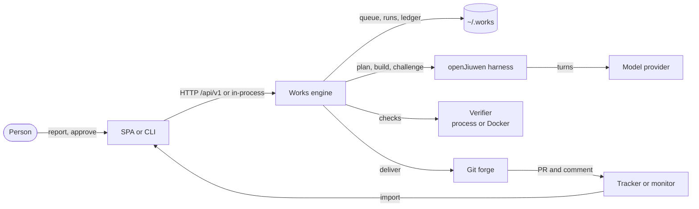
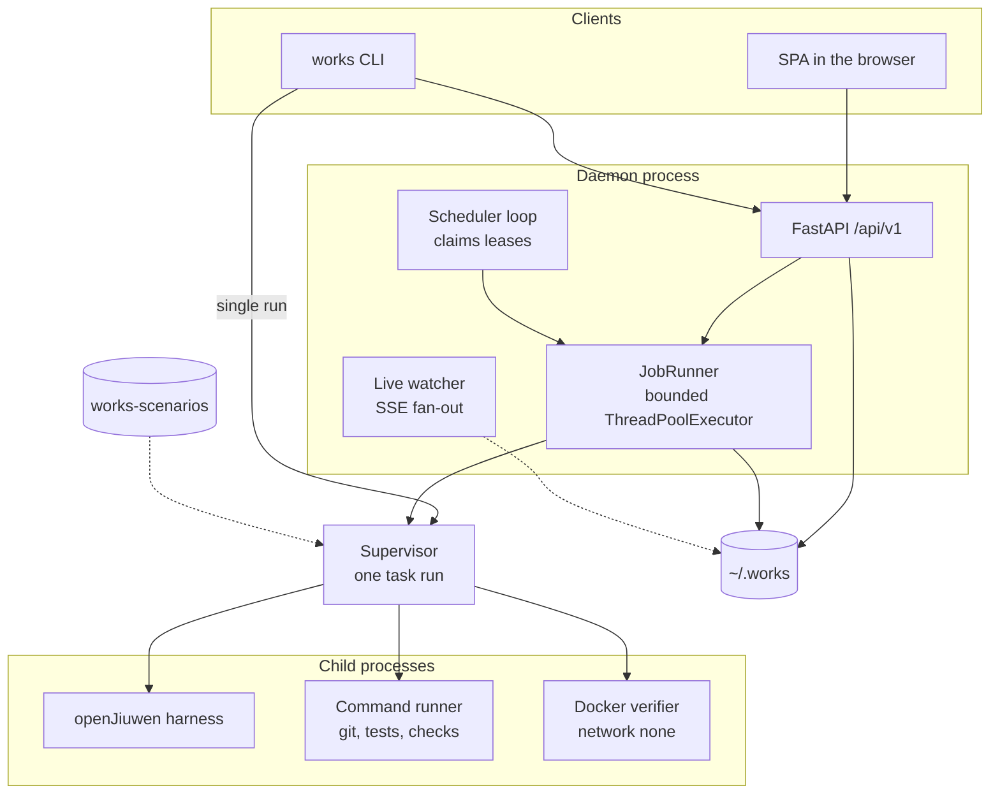
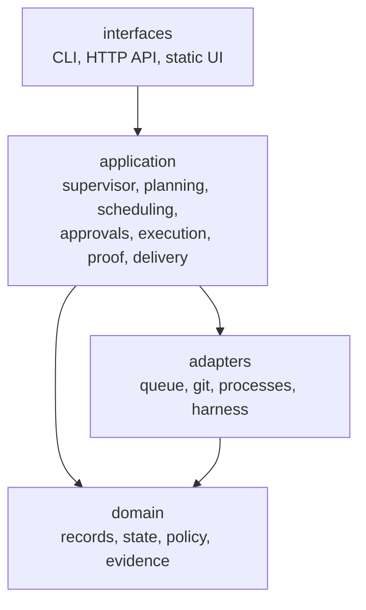
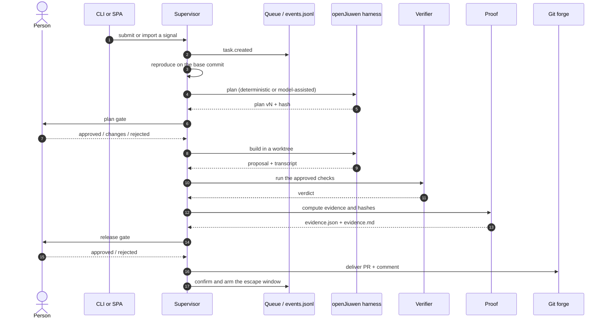
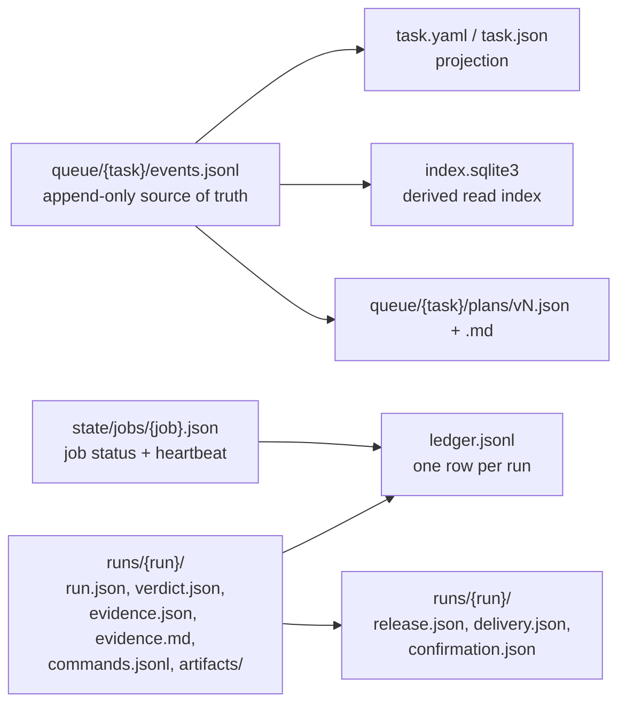

# Architecture

> **Doc status:** active · **Owner:** Michael · **Last reviewed:** 2026-11-27

Works is one local engine around an openJiuwen harness. The CLI and the SPA are two clients of the
same home; the daemon owns background work and the CLI can host a single run in-process. This page is
the system view: where the processes run, how the code is layered, what one run does, and which files
make it durable. Stage contracts stay in [the lifecycle reference](../reference/lifecycle/signal-intake.md);
the planner has its own [component design](../reference/lifecycle/planner.md).

## System context

The home is the unit of state. A run started from the CLI and a run started by the daemon use the same
queue, events, proof and ledger code; the difference is only which process hosts the supervisor.

## Processes

- One daemon owns a writable home (ADR 016); a second daemon on the same home is refused by the lock.
- `JobRunner` is one bounded `ThreadPoolExecutor` (ADR 019). Jobs are persisted under `state/jobs/`
  with a heartbeat and reconciled on restart; a killed job is failed, never silently resumed.
- The scheduler loop only selects and claims. It hands the claimed task to the same run job a person
  would start and never runs or decides a task itself (ADR 024).
- The live watcher polls the workspace and fans out SSE. It never mutates state.
- The verifier is a separate process or a Docker container with no network; the builder does not share
  its credentials or transcript.

## Code layers

| Layer | Path | Owns |
|---|---|---|
| Interfaces | `src/works/interfaces/` | CLI commands, FastAPI routes and middleware, static SPA assets |
| Application | `src/works/application/` | supervisor phases, planning, scheduling, approvals, execution, proof, delivery, memory |
| Adapters | `src/works/adapters/` | queue files and index, git worktree, subprocess runner, openJiuwen/Swarm harnesses, daemon |
| Domain | `src/works/domain/` | pure records, task state machine, policy, risk, evidence rendering |
| Config | `src/works/config/` | home paths, packaged resources, logging, `sys.path` hardening |
| Web | `web/src/` | React SPA, generated OpenAPI client, screens and styles |
| Tests | `tests/unit`, `tests/integration`, `tests/contract` | layer mirrors, whole-loop and Docker/Swarm runs, API parity fixtures |

The dependency rule is one-way: `domain` imports nothing above it; `adapters` and `application` may
import `domain`; `application` may import `adapters`; `interfaces` may import `application`. A module
belongs in the layer whose job it describes, not the layer that happens to call it.

## One run

The two person steps are the only blocking human decisions. A failed check, a mismatched proof or an
expired approval stops the run with a typed reason; it never "passes by default".

## Durable state

- `events.jsonl` is append-only and is the only source of truth. `task.yaml`/`task.json` are
  projections; `index.sqlite3` is a derived read index that can be rebuilt.
- A run directory contains `run.json`, `verdict.json` when a verdict exists, `evidence.json`,
  `evidence.md` and `commands.jsonl`. Builder and challenge phases add `transcript.json`,
  `harness.json`, `challenge.json`, `specialists.json`, `proposal.diff` and `artifacts/` as they run.
- `evidence.json` is the proof; `evidence.md` is a rendering. The proof binds the diff, artifacts,
  event root and page fingerprint, and `works proof verify` recomputes them.
- `ledger.jsonl` is the append-only cost and verdict row per run. `state/jobs/*.json` is the job record
  and heartbeat; `state/jobs-archive.jsonl` holds pruned jobs.
- `config/dispatch.yaml` is the scheduler policy and `flows/` holds the default flows. `worktrees/` is
  disposable. Scenarios live outside the home, in the sibling `works-scenarios` directory.
- One daemon writes; readers never edit a projection by hand.

## Invariants and where they live

| Invariant | Enforced by |
|---|---|
| One supervisor advances a task | `application/supervisor/core.py` |
| Two human gates only: plan and release | `application/approvals/`, [gates](../reference/lifecycle/gates.md) |
| The builder cannot edit the tests that judge it | `domain/policy.py`, `adapters/processes/runner.py` |
| The verifier is independent in runtime and provider | `application/execution/verifier.py` |
| Scenarios live outside the repository | `config/paths.py`, `works-scenarios` |
| Policy sits outside the agent | `domain/policy.py`, enforced by the runner |
| Events are the truth | `adapters/queue/store.py`, `adapters/queue/projection.py` |
| Every verdict and approval is bound to a commit | `application/proof/`, approval records |
| Checks outlive changes | `domain/trusted.py` |
| A new gate starts in observe mode | gate policy and risk records |
| No blocking prompt in the engine path | waits and wake events in `adapters/queue/waits.py` |
| External actions are idempotent | `interfaces/api/idempotency.py`, delivery markers |

## Boundaries

| Boundary | Rule | Record |
|---|---|---|
| Trusted base | Flows, checks, scenarios and risk rules are read from the base commit, not the worktree | ADR 012 |
| Builder | Works in a disposable worktree; the worktree is not a security boundary | ADR 004 |
| Verifier | Separate process or container, no builder transcript, different provider where possible | ADR 005 |
| Policy | Enforced by the runner, never requested from the model | [build](../reference/lifecycle/build.md) |
| Gates | Plan and release are the only human blocks; identity, TTL and quorum are recorded | [gates](../reference/lifecycle/gates.md) |
| Concurrency | One bounded job pool; the scheduler claims, the job runs | ADR 019, ADR 024 |
| Delivery | Idempotent by marker; a crash never silently repeats a PR or comment | [reliability](../reference/platform/reliability.md) |

## Where to change what

| Change | Go to |
|---|---|
| CLI command | `src/works/interfaces/cli/commands/<group>.py` and `.../parser/<group>.py` |
| HTTP route | `src/works/interfaces/api/routes/`, with helpers in `read.py` / `write.py` |
| Run phase | `src/works/application/supervisor/` (`planning`, `execution`, `verification`, `recording`) |
| Planner | `src/works/application/planning/`; design in [planner](../reference/lifecycle/planner.md) |
| Scheduler | `src/works/application/scheduling/` and `interfaces/api/scheduler_loop.py` |
| Queue or index | `src/works/adapters/queue/` |
| Harness | `src/works/adapters/harness/` (`openjiuwen/`, `swarm/`, `fake.py`) |
| Persisted record | Model in `src/works/domain/`, store in `src/works/adapters/` |
| Screen | `web/src/features/<area>/`, with shared primitives in `web/src/ui/` |

## See also

- [Concepts](../start/concepts.md) — the ten stages in plain words.
- [Lifecycle](../reference/lifecycle/signal-intake.md) — stage contracts.
- [Gates](../reference/lifecycle/gates.md) — the two human decisions.
- [Planner](../reference/lifecycle/planner.md) — the planning component design.
- [HTTP API](../reference/platform/http-api.md) and [scheduler](../reference/platform/scheduler.md).
- [Reliability](../reference/platform/reliability.md) — crash, retry and delivery semantics.
- [Layout](../guides/contributing/layout.md) — the contributor's short version of the code map.
- [ADRs](adrs/README.md) — why the expensive choices were made.
