# How a fix gets made

This is the short version of what happens between “a problem was reported” and “the fix is live and
confirmed”. It is written for product people: no internal names, no code.

There are ten steps and **two moments where a person must say yes**. Nothing ships without those two
yeses, and the AI cannot give them to itself.

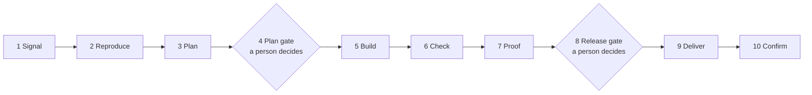

## 1. Signal — someone reports a problem

A problem can arrive in five ways: a person types it into the app, an issue is pulled in from a
tracker, monitoring raises it, a source sends it automatically through a signed webhook, or an AI
assistant tool hands it in.

A good signal is more than a sentence. It says how serious it is, who reported it, where it came
from, links to the original report, and — when possible — how the reporter thinks it can be
reproduced. Automatic senders prove they are genuine, cannot replay the same message twice, and are
slowed down if they get noisy.

If the same problem arrives twice, it is not silently added again. It is grouped with the existing
one, and a person can merge it, ignore the source, or turn it into work.

Nothing has been looked at in the code yet. At this point we have a claim, its context, and a hint
about how to check it. The next step is automatic; a person is only needed if the report is ambiguous
or looks like a duplicate.

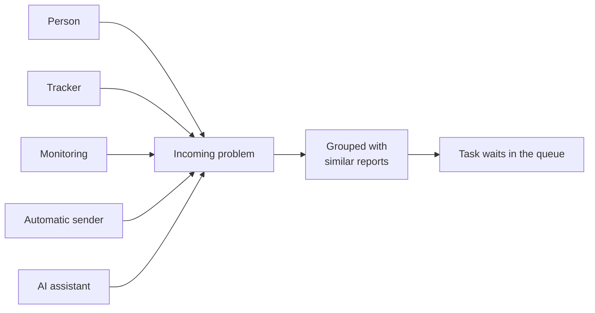

## 2. Reproduce — see the problem actually happen

Works gets the right code first. A report can point at a link to the repository plus a specific
branch, saved version or proposed change (a pull request); Works keeps its own copy and checks out
exactly what was asked for. If that version does not exist, the task stops with a clear reason
instead of quietly using the main branch. A local folder still works for offline use.

It then takes an untouched copy of exactly that version: nobody’s uncommitted changes, no other
branch mixed in. The fix will be written there, never in the folder where people are working.

Next it decides **how to test the problem**, in this order:

1. the repository’s own instruction, when the team provided one;
2. the failing test named in the report, if the report names one;
3. the standard test command for that kind of project (Python, Node, Go, Rust, Java).

It records which of the three it used, so the proof says whether a person chose the test or Works
picked a default.

The test runs with that project’s own dependencies, prepared separately, so it does not matter what
is installed on your machine. Works never downloads dependencies silently during a run; a person
prepares the environment once.

- **fails on both runs** — the problem is confirmed, and that failure becomes the evidence the fix must satisfy;
- **fails once, passes on a second try** — “flaky”: not confirmed, because the proof would be built on luck;
- **fails because something is missing** — a setup problem with a clear reason, not a bug;
- **passes** — the test does not show the problem; the work stops as “could not reproduce”.

The person can see the command on the Proof page (“How to reproduce”) and replace it when they know a
better one. The reporter’s hint is shown as advice and never executed blindly.

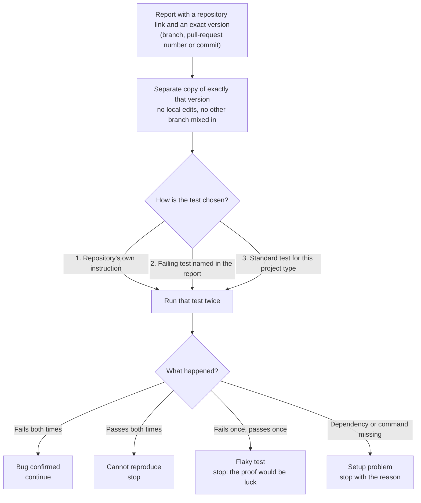

## 3. Plan — agree what will change

Works writes a short plan: which checks must pass, which parts of the product may change, which saved
version it starts from. By default the plan is mechanical: the same input gives the same plan, so two
people can compare plans without guessing.

The plan is tied to that exact starting version and to that exact set of checks. If either moves, the
plan is out of date and has to be redone instead of quietly reused.

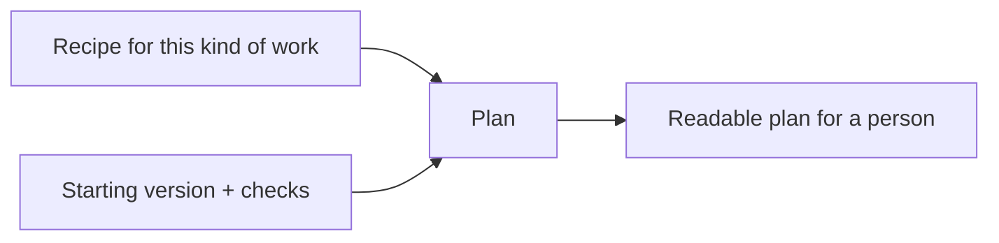

## 4. Plan gate — a person says “yes, this is the right plan” 🔒

This is the first mandatory human moment. A person reads the plan and approves it. Works records who
approved, when, and exactly which plan.

The builder cannot approve its own plan, and an approval for an older plan no longer counts. A task
without this yes simply cannot move to building.

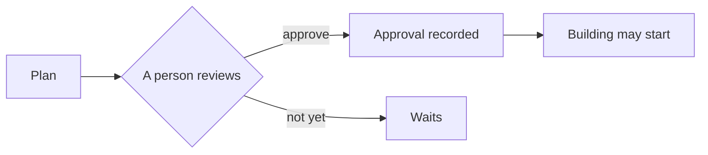

## 5. Build — the change is made

The chosen engine works inside that untouched copy: Jiuwen native, DeepSeek, Codex or Claude Code. It edits
files, runs commands and iterates until the plan’s checks look satisfied.

The engine can propose and edit; it cannot approve, release or touch the evidence. The list of changed
files comes from the codebase itself, not from the engine’s summary. If it goes outside the agreed
area, runs out of time or money, or stops without a change, the task stops visibly with a reason.

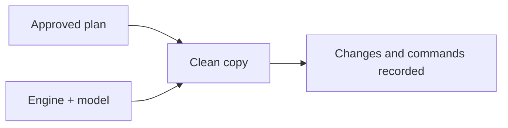

## 6. Check — prove the change works

Works runs the checks from the plan and applies the product’s rules (for example: tests must not be
edited to make a build pass). The most important checks decide the outcome: one failing must-pass
check blocks the release instead of being explained away.

A separate reviewer can challenge the change, ideally with its own credentials, so the same mind does
not grade its own homework. The result is a clear allow or block, not a paragraph of adjectives.

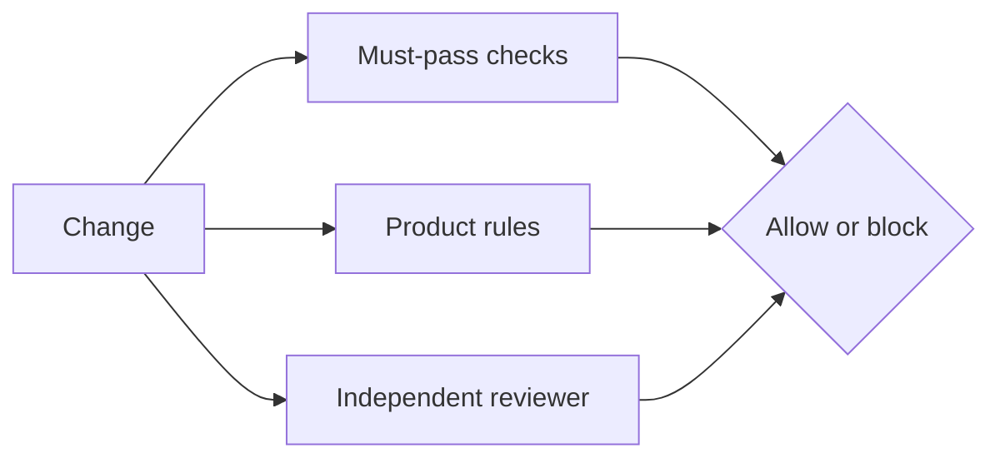

## 7. Proof — write it down on one page

Everything is collected on a single evidence page: what changed, what was run, the outcome, the risk,
which model and engine did the work, and what it cost. A fingerprint ties the page together, so any
later edit is visible.

This page is what a person reads before deciding to ship. It is also what makes two pieces of work
comparable: same layout, same units, whether a test fixture or a live model produced it.

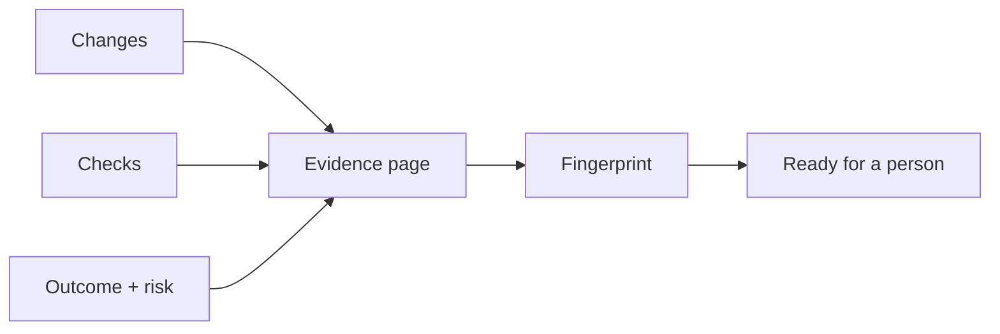

## 8. Release gate — a person says “yes, ship it” 🔒

This is the second mandatory human moment. A person reviews the release packet: the saved version, the
fingerprint and any blockers. Approving it marks the task released.

Works refuses this gate when the work is not proved, when a must-pass check failed, when a rule was
broken, or when no person has approved it. This is the last moment before code leaves the machine, and
it belongs to a person on purpose.

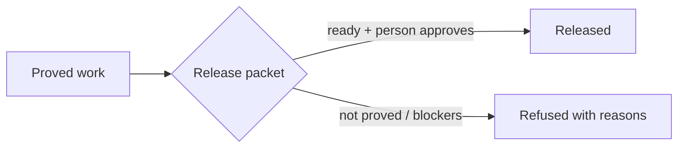

## 9. Deliver — send it back where it came from

Works creates a change branch, opens a change request, and can leave one comment on the original
report. Before sending, it checks that the code still matches the approved proof, so nobody ships a
different change than the one that was approved.

There is also a rehearsal mode that prepares everything but sends nothing. Repeating delivery is safe:
the same change request and the same comment are found instead of being created twice.

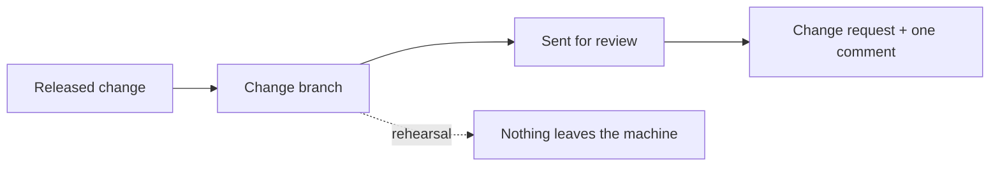

## 10. Confirm — check the real thing afterwards

After delivery — and optionally after the owner’s own deployment — Works checks the real result: a
live address, a command against a fresh copy, or the deployment script itself. The result is stored
next to the evidence.

A failed confirmation is not hidden: it is visible beside the proof. When it passes, the story ends
with “delivered and confirmed”, which is very different from “sent and hopefully fine”.

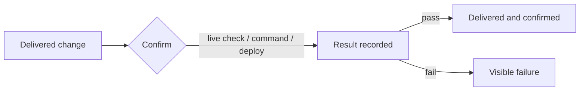

## The two gates in one sentence

**Plan gate:** “is this the right plan?” **Release gate:** “is this proof good enough to ship?” Both
are answered by a person, both are recorded with the exact version and proof, and neither can be
bypassed by the builder.
