# How a fix gets made

This is the short version of what happens between “a problem was reported” and “the fix is live and
confirmed”. It is written for product people: no internal names, no code.

There are ten steps and **two moments where a person must say yes**. Nothing ships without those two
yeses, and the AI cannot give them to itself.

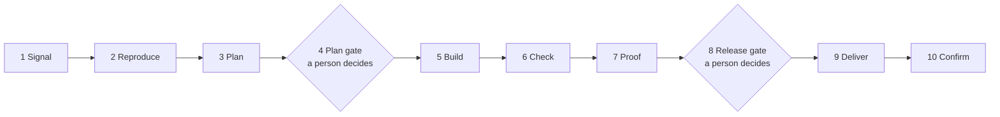

## 1. Signal — someone reports a problem

A problem can arrive in five ways: a person types it into the app, an issue is pulled in from a
tracker, monitoring raises it, a source sends it automatically through a signed webhook, or an AI
assistant tool hands it in.

A good signal is more than a sentence. It says how serious it is, who reported it, where it came
from, links to the original report, and — when possible — how the reporter thinks it can be
reproduced. Automatic senders prove they are genuine, cannot replay the same message twice, and are
slowed down if they get noisy.

If the same problem arrives twice, it is not silently added again. It is grouped with the existing
one, and a person can merge it, ignore the source, or turn it into work.

Nothing has been looked at in the code yet. At this point we have a claim, its context, and a hint
about how to check it. The next step is automatic; a person is only needed if the report is ambiguous
or looks like a duplicate.

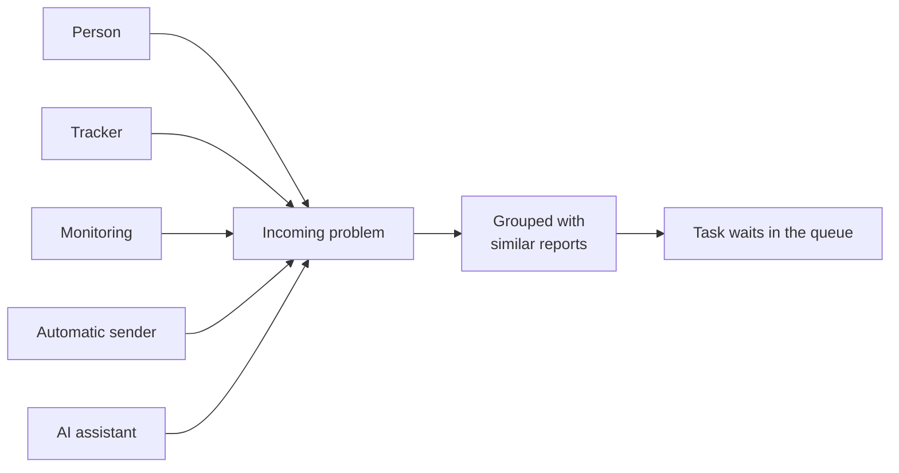

## 2. Reproduce — see the problem actually happen

Works gets the right code first. A report can point at a link to the repository plus a specific
branch, saved version or proposed change (a pull request); Works keeps its own copy and checks out
exactly what was asked for. If that version does not exist, the task stops with a clear reason
instead of quietly using the main branch. A local folder still works for offline use.

It then takes an untouched copy of exactly that version: nobody’s uncommitted changes, no other
branch mixed in. The fix will be written there, never in the folder where people are working.

Next it decides **how to test the problem**, in this order:

1. the repository’s own instruction, when the team provided one;
2. the failing test named in the report, if the report names one;
3. the standard test command for that kind of project (Python, Node, Go, Rust, Java).

It records which of the three it used, so the proof says whether a person chose the test or Works
picked a default.

The test runs with that project’s own dependencies, prepared separately, so it does not matter what
is installed on your machine. Works never downloads dependencies silently during a run; a person
prepares the environment once.

- **fails on both runs** — the problem is confirmed, and that failure becomes the evidence the fix must satisfy;
- **fails once, passes on a second try** — “flaky”: not confirmed, because the proof would be built on luck;
- **fails because something is missing** — a setup problem with a clear reason, not a bug;
- **passes** — the test does not show the problem; the work stops as “could not reproduce”.

The person can see the command on the Proof page (“How to reproduce”) and replace it when they know a
better one. The reporter’s hint is shown as advice and never executed blindly.

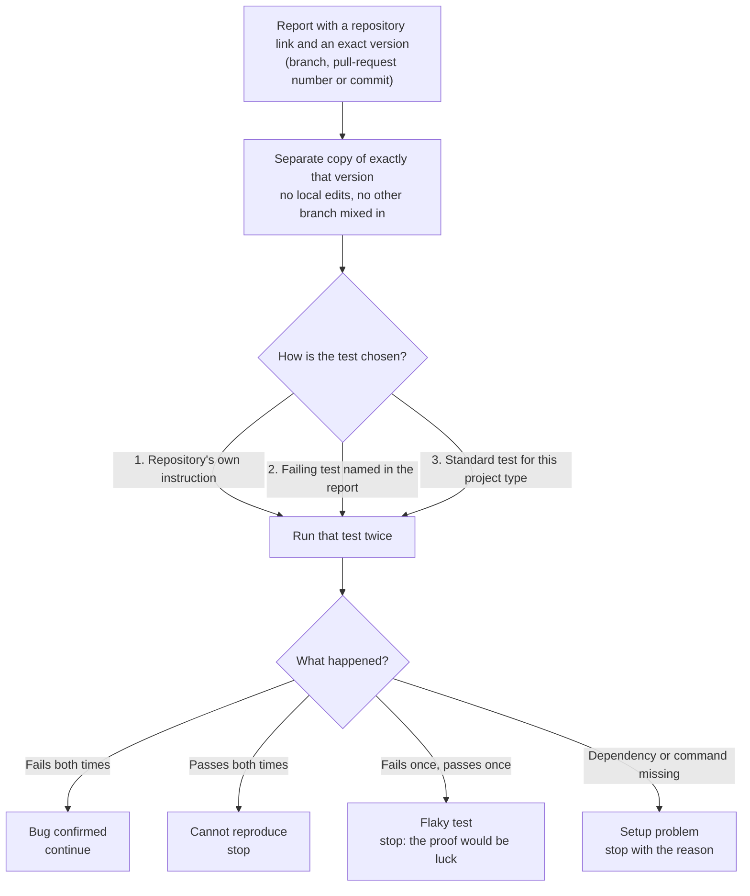

## 3. Plan — agree what will change

Works writes a short plan: which steps will be taken, what “done” means for each step, which tests
must pass, which parts of the product may change, and which saved version it starts from. By default
the plan is mechanical: the same inputs give the same plan and the same fingerprint, so two people can
compare plans without guessing.

Before a person sees it, Works runs fixed checks on the plan (no person and no AI decides here ? the rules are code):

- every step has a definition of done, and every command it names actually exists;
- the files named in the report are matched to the tests that cover them; files with no covering test
  are listed as gaps instead of being hidden;
- the estimated time and cost are compared with the task budget, and an over-budget plan is flagged
  before anyone spends money;
- optionally, a separate AI reviewer (with its own credentials, so it is not grading its own work) can challenge the plan; a low score blocks it. That reviewer is a model, not a person.

A person can rework the steps — reword the intent, tighten “done when”, add or remove a step within
the kinds of work already agreed — and leave a comment. That creates a **new version with a new
fingerprint**; the previous approval stops counting. The plan is also tied to that exact starting
version and test set, so if either moves, the plan is out of date and must be redone.

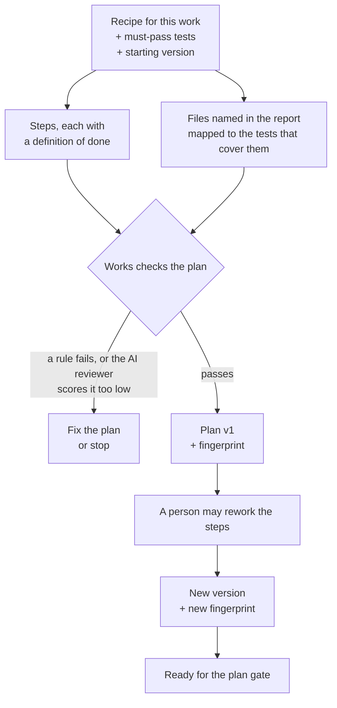

## 4. Plan gate — a person says “yes, this is the right plan” 🔒

This is the first mandatory human moment. The decision screen gathers everything the decision needs:

- the plan and **what changed** since the previous version;
- which files named in the report are covered by tests, and which are gaps;
- the time and cost estimate against the task budget;
- the independent reviewer’s concerns and score;
- the risk level and the owners of the affected areas.

Approve stays unavailable while an automatic check fails. A person decides with all of that in front of
them, not from a chat reply.

There are three answers, not one:

- **Approve** — building may start.
- **Ask for changes** — a comment is required; the task stays in planning until a new version arrives.
- **Reject** — a reason is required; the work stops.

The approver is a **named person on a device**. An AI agent cannot approve, and the same person
cannot count twice when the optional two-person rule is on. The approval is tied to that exact plan
fingerprint and expires after about a week; editing the plan, moving the starting version or changing
the tests all cancel it. Works records who decided, when, from which device, and for which plan — in a
history that cannot be edited afterwards. The same record is what a later audit reads.

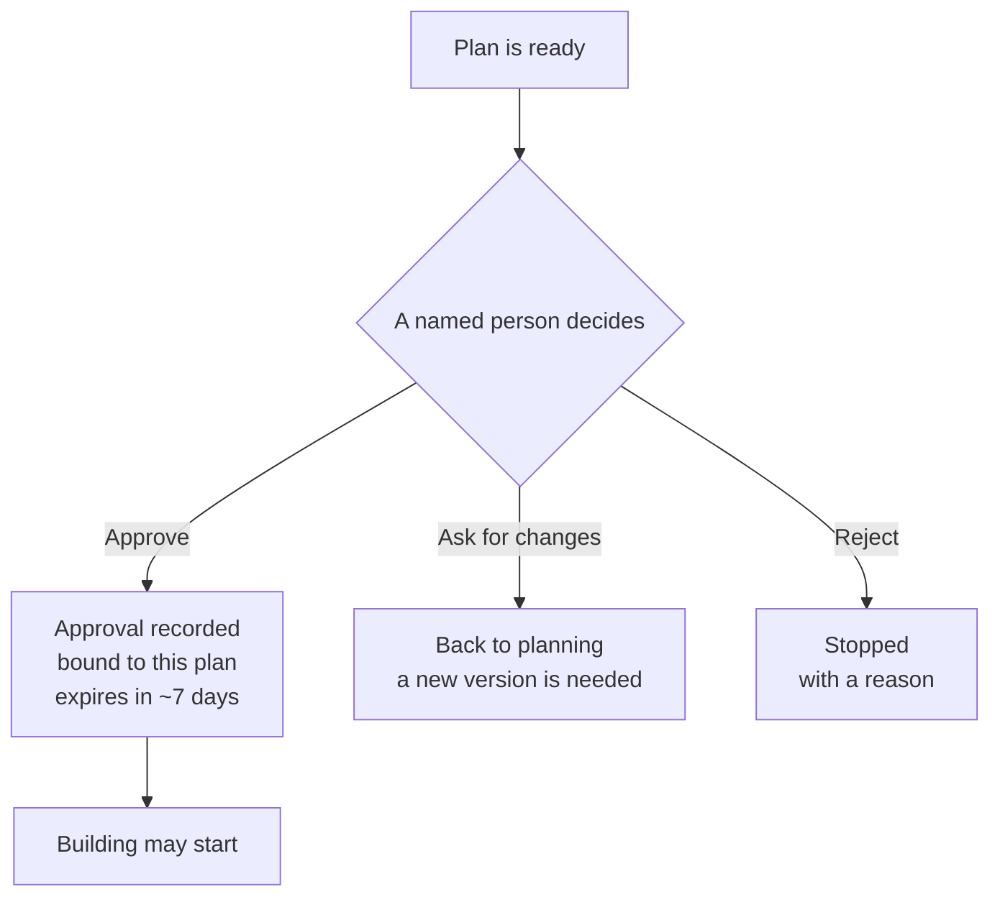

## 5. Build — the change is made

The chosen engine works inside that untouched copy: Jiuwen native, DeepSeek, Codex or Claude Code. It edits
files, runs commands and iterates until the plan’s checks look satisfied.

The engine can propose and edit; it cannot approve, release or touch the evidence. The list of changed
files comes from the codebase itself, not from the engine’s summary. If it goes outside the agreed
area, runs out of time or money, or stops without a change, the task stops visibly with a reason.

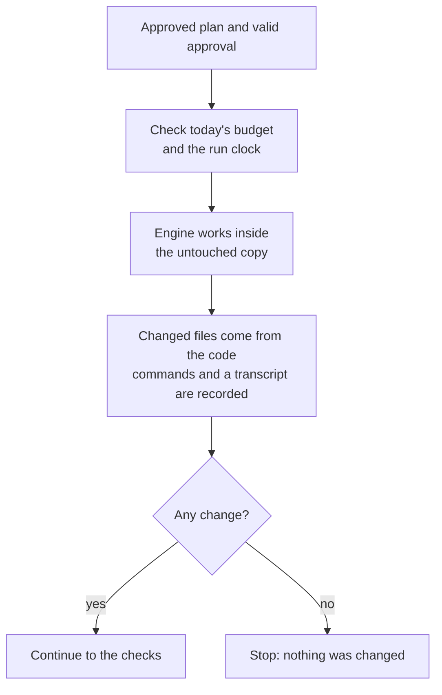

## 6. Check - prove the change works

Works runs the checks from the plan and applies the product’s rules (for example: tests must not be
edited to make a build pass). The most important checks decide the outcome: one failing must-pass
check blocks the release instead of being explained away.

A separate reviewer can challenge the change, ideally with its own credentials, so the same mind does
not grade its own homework. The result is a clear allow or block, not a paragraph of adjectives.

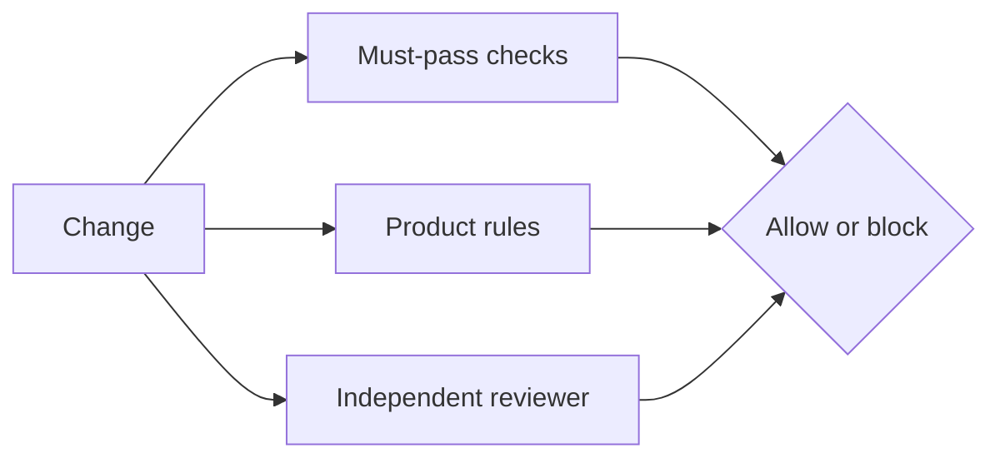

## 7. Proof — write it down on one page

Everything is collected on a single evidence page: what changed, what was run, the outcome, the risk,
which model and engine did the work, and what it cost. A fingerprint ties the page together, and the
page can be **re-checked**: the diff, every attachment and the event history are recomputed, so an edit
after the fact is visible instead of being trusted.

The page also says what it could not show: skipped checks, redacted credentials, the exact versions it
ran with, and ? when the checks ran on the original version ? the comparison. It can be exported as an
offline bundle with hashes, and two proofs can be compared. There is no signing or blockchain: those
need a real publish process, and a signature nobody checks proves nothing.

This page is what a person reads before deciding to ship. It is also what makes two pieces of work
comparable: same layout, same units, whether a test fixture or a live model produced it.

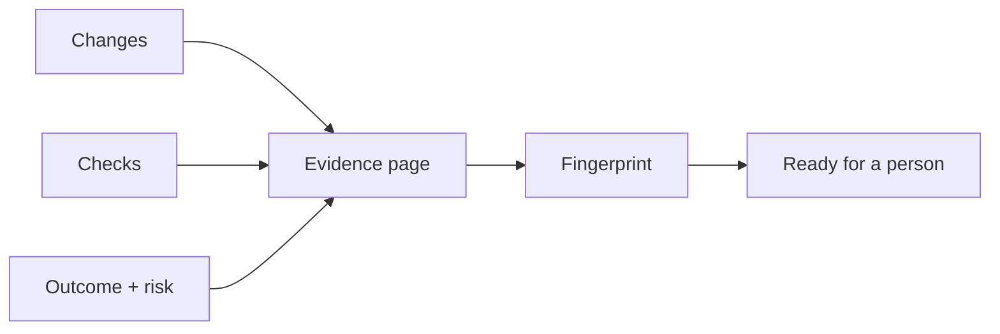

## 8. Release gate — a person says “yes, ship it” 🔒

This is the second mandatory human moment. The release packet gathers what the decision needs: what
exactly ships, the proof and whether it still **verifies**, the risk and the owners of the touched
areas, the verdict and the checks that were not run, the cost estimate against the actual, the
delivery target and the rollback.

There are three answers, not one:

- **Approve** ? the task becomes released, and delivery may run.
- **Hold** ? a comment is required; the task stays proved until the packet changes.
- **Reject** ? a reason is required; the work stops.

The approver is a **named person on a device**; an AI agent cannot release. For risky areas the
approval must come from one of the named owners, and an optional two-person rule can require a second
person on another device. The approval expires after about three days, and any new proof or commit
invalidates it. Works refuses the gate while any blocker remains: not proved, a failing must-pass
check, a policy violation, a blocked review, a proof that no longer verifies, a stale approval, or no
delivery target. Every decision is written to an append-only history.

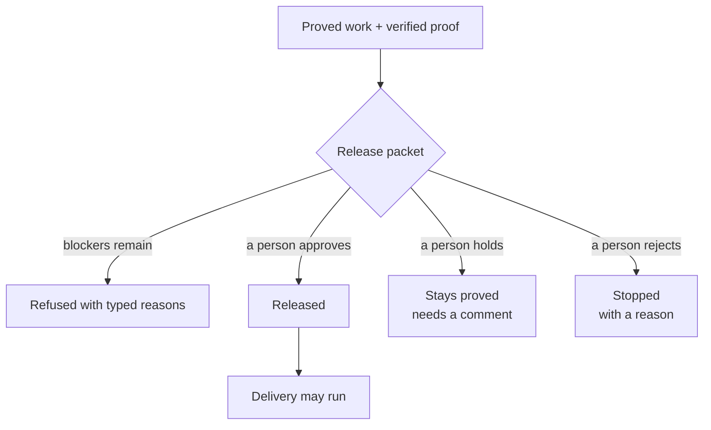

## 9. Deliver — send it back where it came from

Before anything leaves the machine, Works checks that the delivered commit really descends from the
approved base and that the proof still matches; a mismatch stops the delivery. It never force-pushes
and never merges.

It then creates a branch, pushes it, opens a change request and leaves one comment on the original
report. The request carries the proof summary, the verdict, the risk, which checks passed and what was
not tested ? not just a link. A rehearsal mode prepares the branch and the text but sends nothing.

Delivery writes a step-by-step journal (branch, commit, preflight, push, change request, comment). A
crash after the change request does not create a second one: the journal says where it stopped, and a
retry continues from there. A missing token is refused before any network write, and a partial
delivery is shown as partial, never as success.

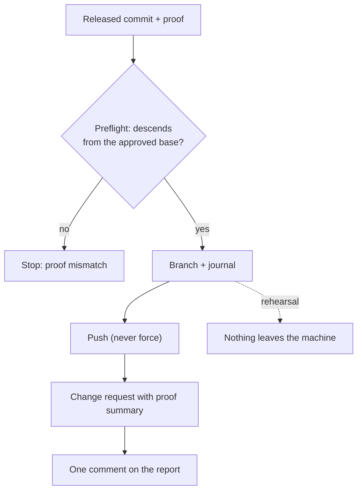

## 10. Confirm — check the real thing afterwards

After delivery — and optionally after the owner’s own deployment — Works checks the real result: a
live address, a command against a fresh copy, or the deployment script itself. The result is stored
next to the evidence.

A failed confirmation is not hidden: it is visible beside the proof. When it passes, the story ends
with “delivered and confirmed”, which is very different from “sent and hopefully fine”.

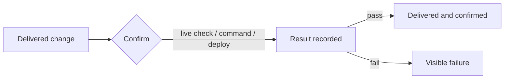

## The two gates in one sentence

**Plan gate:** “is this the right plan?” **Release gate:** “is this proof good enough to ship?” Both
are answered by a person, both are recorded with the exact version and proof, and neither can be
bypassed by the builder.
