# How a fix flows through Works

Works is a small factory that lives on your computer. A problem goes in, a checked and documented fix
comes out, and two human approvals sit in the middle. This page walks through the ten stages in plain
English; the two that need a person are marked **gate**.

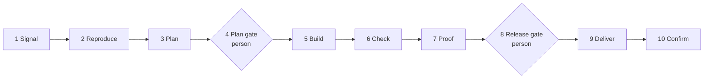

The builder never opens a gate. A person does, and the approval is written into the run's history with
the commit and the proof fingerprint, so it cannot be replayed or forged later.

## 1. Signal — read the signal

A problem arrives from one of three places: a person types it in the interface, a tracker issue is
imported, or monitoring notices something. Works turns it into a task with a title, a source reference,
a product, a repository and a flow (the recipe for this kind of work). The same source reference is not
turned into a second task: submitting it twice returns the task that already exists.

The task starts in `queued` and appears in the queue, grouped by what it needs from a person. Nothing
has been read from the repository yet; the signal is only a claim until the next stage confirms it.

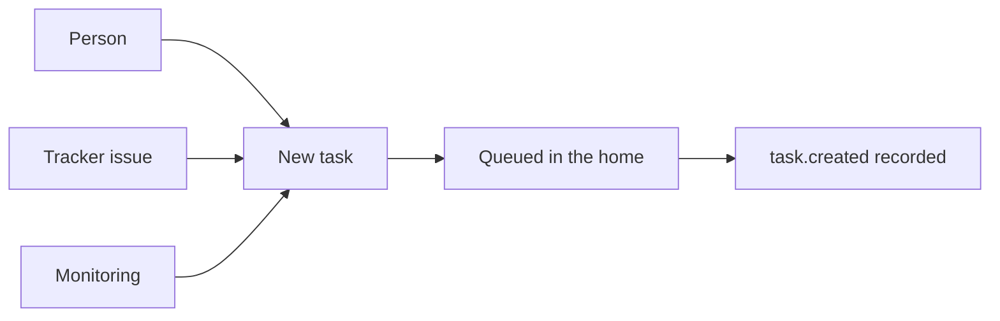

## 2. Reproduce — see the problem happen

Works makes a clean copy of the repository (a “worktree”), so the fix will never be written on top of
somebody's unfinished work. In that copy it runs the command that should demonstrate the bug, usually a
test. The command's exit code, a short slice of its output and a hash of the full output are stored.

If the command fails, the problem is confirmed and the failure becomes evidence: the fix will have to
make exactly this check pass. If the command passes, Works stops and marks the task
`not_reproducible`; building a fix for a problem nobody can see would produce a proof that proves
nothing.

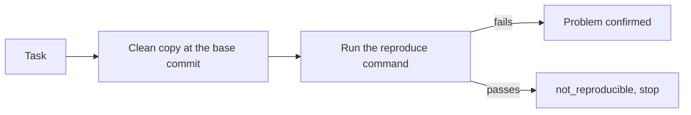

## 3. Plan — decide what will change

Works writes a short, reviewable plan: the scenarios that must pass, the files it expects to touch, the
base commit, and a hash of the checks themselves. By default the plan is deterministic — the same flow
and the same scenarios always produce the same plan — so you can compare two plans without guessing
what the model felt like doing that day.

There are also model-assisted modes (a proposal beside the plan, a merged proposal, an independent
critic), but they all end in the same artefact. A plan is tied to a specific base commit and check set;
if either moves, the plan is stale and has to be redone rather than silently reused.

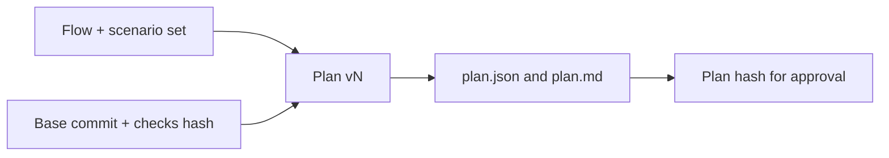

## 4. Plan gate — a person says go (**gate**)

A person reads the plan and approves it. Works records who approved, when, the commit, the checks hash
and the plan hash. That record is part of the task's history, not a checkbox in the interface.

This is the first of the two places where a human is mandatory. The builder, the planner and any
reviewer model can propose, but none of them can approve. A task without this approval simply cannot
reach the build stage, and an approval for an older plan no longer matches the hash.

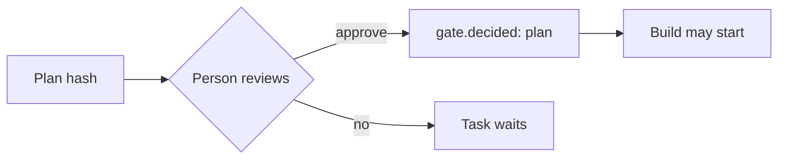

## 5. Build — make the change

The chosen engine now works inside the clean copy. The engine is one of Jiuwen native, DeepSeek
Harness, OpenAI Codex or Claude Code; the model behind it is a separate choice, and both are written
into the run record so a proof always says what produced it. The engine edits files, runs commands and
iterates until the plan's checks look satisfied.

Works watches the worktree, not the engine's imagination: the changed files are collected from git,
not from the model's summary. Paths outside the allowed scope, a missing model key, a run over its time
or token budget, or an engine that stops without a change all end as a visible `blocked` state with a
reason — never as a quiet success.

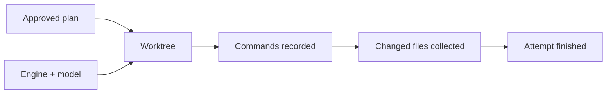

## 6. Check — prove the change works

Works runs the scenario scripts from the plan — small, independent programs that assert user-visible
behaviour — and applies the policy rules (protected paths, forbidden edits). The highest-priority
scenarios decide the verdict: one failing must-pass scenario blocks the release instead of being
explained away.

A separate reviewer can also challenge the change, ideally with its own model credential, so the same
mind does not grade its own homework. All outcomes are stored with exit codes and output hashes; the
summary is a plain ALLOW or BLOCK, not a paragraph of adjectives.

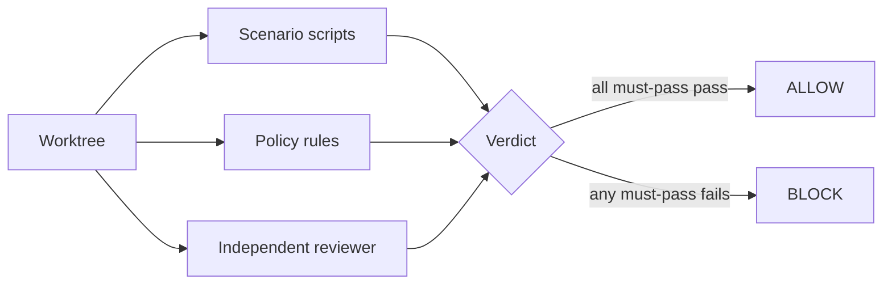

## 7. Proof — write it down

Everything is collected on one evidence page: the diff, the file list, command outputs, the verdict,
the risk level, the decision, the model, the engine, the prompt hash and the cost in tokens and money.
A fingerprint (SHA-256) is calculated over the bound page, so any later edit is visible.

The proof is what a person reads at the release gate. It is also what makes two runs comparable: the
same schema, the same hashes, the same units, whether a fake trace or a live model produced the work.
The task sits at `proved` at the end of this stage — done, but deliberately not shipped.

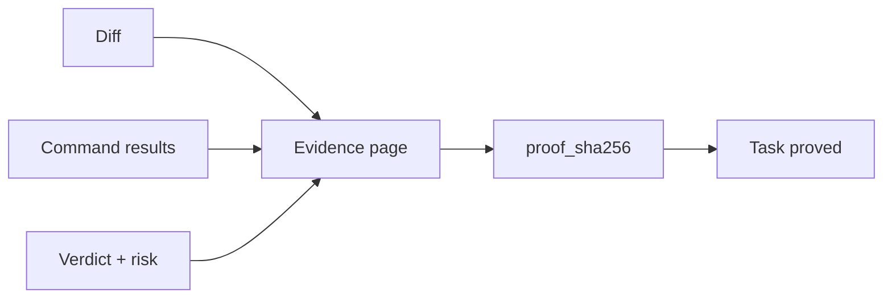

## 8. Release gate — a person says ship (**gate**)

A person reviews the release packet: the commit, the proof fingerprint and any blockers. Approving it
marks the task `released` and records the same kind of history entry as the plan gate.

Works refuses to open this gate when the task is not proved, when a must-pass check failed, when the
policy was violated, or when the gate has no human approval yet. The point is not ceremony: this is the
last moment before code leaves the machine, and it is deliberately owned by a person.

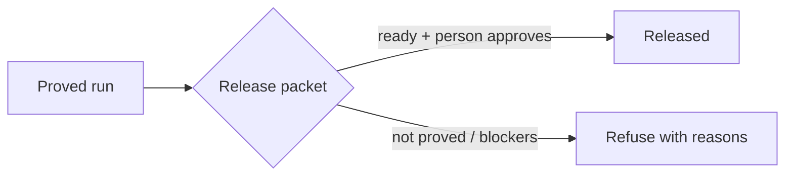

## 9. Deliver — send it back

Works pushes the branch and opens a pull request, and can leave one comment on the original issue.
Before pushing it checks that the worktree still matches the proof, so nobody delivers a different
change than the one that was approved. A dry run prepares the branch and the commit but touches
neither the network nor the forge.

Repeating the step is safe: the pull request and the comment are found by their marker instead of being
created twice, and a recorded delivery is reused when the commit has not changed. No token, cookie or
secret is copied into the output.

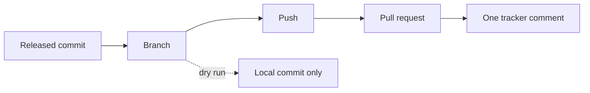

## 10. Confirm — check the result after delivery

After the fix is delivered — and optionally deployed by the owner's own command — Works checks the real
thing: an HTTP endpoint, a command in a fresh copy of the released commit, or the deploy script itself.
The check is recorded with its exit code and a hash of its output.

A confirmation that fails is not hidden: it is stored beside the evidence and the task says so. When
everything passes, the story ends with “delivered and confirmed”, which is a very different statement
from “pushed and hopefully fine”.

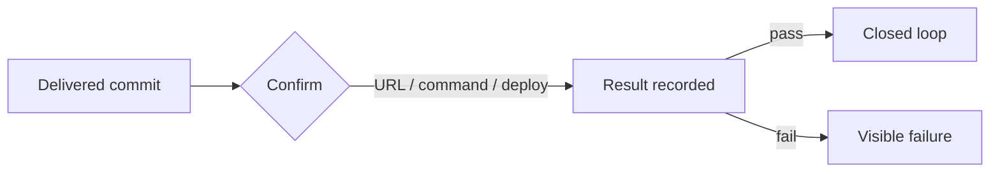

## The two gates in one sentence

**Plan gate** asks “is this the right plan?” and **release gate** asks “is this proof good enough to
ship?” — both are answered by a person, both are recorded with the commit and the proof fingerprint,
and neither can be bypassed by the builder.
