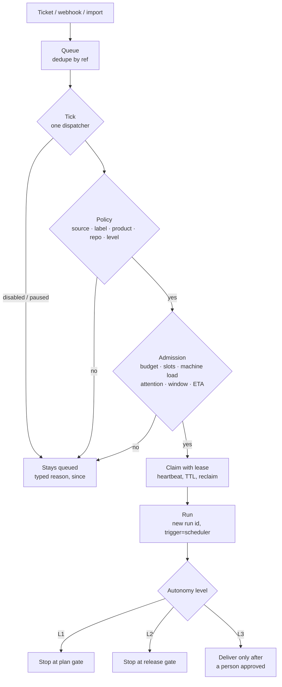
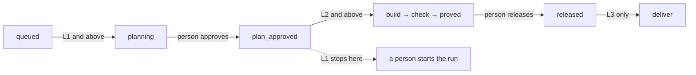
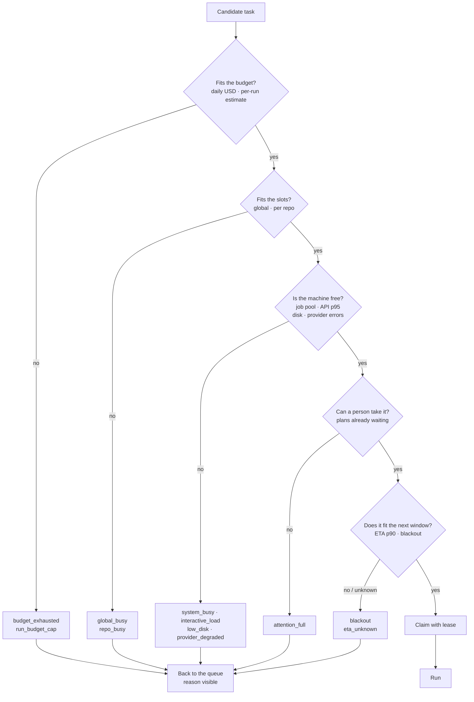

# M21 — queue and scheduler (design)

> **Doc status:** archived · **Owner:** Michael · **Last reviewed:** 2026-11-26

Status: complete (M21.1–M21.12). The first pass covered policy, selection, leases, pause and one CLI
tick; the daemon loop, HTTP surface, GUI, import triggers and bounded retries landed with it. The
checkboxes live in `docs/roadmap/archive/2026-modern-plan.md`, and the actor rule is ADR 024.

## The problem

Today an incoming ticket creates a task in `queued` and stops. Starting work is a separate, explicit
act (`works run`, `works dispatch`, `POST /runs`). That is safe but incomplete: there is no sanctioned
way to say "run what is allowed, within limits, and stop where a person is needed". The only
alternatives were "start every ticket by hand" or "fire a run in the webhook handler", and the second
one is wrong:

- webhook deliveries repeat, so the same `ref` starts twice;
- a burst of twenty issues starts twenty models and burns the daily budget in a minute;
- one bad ticket blocks the repository and everything behind it;
- a run started while the person is using the UI makes the whole tool feel broken;
- ten plans queued for approval at once are not throughput, they are a backlog;
- there is no priority, no answer to "why is this task not running", and no kill switch.

Other factories solve this with an internal queue and a worker. We already have the queue, the claim
(`owner`), the journal and the budgets. What is missing is the **selection step** — policy, capacity
and the state of the machine — and a scheduler that explains every decision it makes.

## Model: arrival and execution are separate



Four rules make this safe:

1. **A trigger only enqueues.** A webhook, an import or a label never starts a run. It writes a task
   and (optionally) a `scheduler.requested` event.
2. **One dispatcher decides.** Exactly one process holds the dispatcher lock and claims tasks; CLI and
   daemon share the same selection function, so there is no second policy path.
3. **Admission is explicit.** Policy says whether a task *may* run; admission says whether it *should
   run now*. Both are checked before the claim, and both produce a typed reason.
4. **The scheduler never decides a gate.** It may run *after* a person decided; it may never approve a
   plan or a release.

## What can run when

A level is a **ceiling**, not a one-shot. Approving a gate unblocks the next segment, and the
scheduler claims whatever is runnable up to its ceiling. Without this, approving a plan would leave the
task sitting in `plan_approved` until someone typed `works run` again.

| level | claims | after the plan is approved | after the release is approved |
|---|---|---|---|
| **L1** | `queued` | no — a person starts the build | — |
| **L2** | `queued`, `plan_approved` | yes: build → check → proof | no — a person delivers |
| **L3** | `queued`, `plan_approved`, `released` | yes | yes: deliver |



Everything else (`building`, `checking`, `proved`, `waiting_*`, `blocked`, `delivered`) is never
claimed: a run in progress is owned by its lease, a waiting task waits for its event, and a blocked
task waits for a person.

## Where it runs

The scheduler is **not a service and not a microservice**. It is an optional loop inside the daemon —
the only process that already owns the home, the queue files, the job pool and the lock (ADR 016) —
plus the same loop in `works dispatch --watch` for headless use.

- **One implementation, two hosts.** The daemon hosts a thread (opt-in, paused by default); the CLI
  hosts the identical function in the foreground. Both take the dispatcher lock, so only one claims.
  Two hosts are not two policies: the selection code is shared.
- **It never executes a run.** A claim submits a job to the existing bounded pool; the supervisor runs
  it exactly as for a manual `works run`. The tick itself only reads files and computes, so it costs
  milliseconds.
- **Remote clients only read.** A phone or another browser sees `/api/v1/scheduler`; it does not host a
  scheduler, and it cannot split one home between machines.
- **No broker, no queue service, no cloud worker.** If a split ever becomes necessary, the seam is
  `POST /api/v1/dispatch`: another process would be a client of the same decision, not a second source
  of truth.

Estimates follow the same rule: the backtest is a CLI command over stored runs, and the estimate is a
pure function. There is no estimating service.

## Policy

One file, read on every tick: `~/.works/config/dispatch.yaml`. It is the only place that answers
"what may run". Defaults are off.

```yaml
enabled: false             # nothing is claimed until this is true
tick_seconds: 10

levels:
  default: L1              # L1 triage+plan, L2 to proof, L3 deliver after approval
  by_source:
    github: L1
    jira: L1
    detector: L2

allow:
  sources: [github, jira, detector]
  labels: ["works:auto"]   # empty = any label, but only for manual creation
  labels_deny: ["works:hold"]   # an explicit opt-out always wins
  manual: false            # a task typed in the GUI waits for the Run button
  flows: []                # empty = all flows; else only these
  products: []             # empty = all configured
  repos: []                # empty = all configured
  remote_triggers: false   # imports from a non-loopback client are refused
  risk_max_for_L2: medium
  risk_max_for_L3: medium

concurrency:
  global: 2                # safe across repositories; raise deliberately
  per_repo: 1              # one worktree, one pinned base: never more

budget:
  daily_usd: 20            # overrides WORKS_DAILY_USD when set
  per_run_usd: 5           # pre-flight estimate cap
  on_exhausted: skip       # skip | pause

queue:
  max_age_hours: 72
  max_attempts: 2          # scheduler-driven attempts, excluding manual runs
  backoff_seconds: 300
  starvation_boost_hours: 24   # a low-risk task this old is treated as high

resources:
  pause_when_job_pool_pct: 80
  pause_when_api_p95_ms: 300
  min_free_disk_gb: 5
  pause_on_provider_errors: 3   # within ten minutes

attention:
  max_waiting_plans: 3     # a person can only decide so many at once

windows:
  blackout: ["02:00-02:30"]     # backup/prune; no long run starts here

estimates:
  source: history          # history | plan | static
  min_samples: 5
  max_wall_clock_minutes: 90

priority:
  order: [risk, budget_fragility, starvation, size, age]
  size_buckets:           # coarse on purpose: exact minutes are not knowable
    small_max_minutes: 15
    large_min_minutes: 45

paused: false
```

Validation is strict and typed: an unknown key, a level outside `L1..L3`, a negative limit, or
`risk_max_for_L3` above `medium` is a `config_error` at load, not a surprise at claim time. A missing
file means "disabled", not "run everything": the safe state is always the one that does nothing.

## Selection and admission

Selection is a pure function over (task, queue, policy, budget, locks, signals), so it is testable
without a run. The order matters: the cheapest checks first, the ones that need sampling last.

| stage | question | typical refusals |
|---|---|---|
| task | is this runnable at all? | `not_runnable`, `stale`, `duplicate`, `waiting_on_event`, `risk_too_high`, `attempts_exhausted`, `backoff`, `stale_approval` |
| policy | may it run here? | `disabled`, `paused`, `not_allowlisted`, `missing_label`, `denied_label`, `flow_not_allowed`, `remote_trigger` |
| capacity | is there room? | `repo_busy`, `global_busy`, `budget_exhausted`, `run_budget_cap` |
| machine | is the host free? | `system_busy`, `interactive_load`, `low_disk`, `provider_degraded` |
| attention | can a person take it? | `attention_full` |
| window | does it fit the time? | `blackout`, `eta_unknown` |

Every refusal is recorded with a typed code, never a silent skip:

| code | meaning |
|---|---|
| `disabled` | `enabled: false` |
| `paused` | the kill switch is on |
| `not_runnable` | the task state is not claimable at this level |
| `not_allowlisted` | source/product/repo not allowed |
| `missing_label` | imported task without the required label |
| `denied_label` | `labels_deny` matched; an opt-out beats any allow |
| `manual_not_allowed` | a person-created task, and `allow.manual` is false |
| `flow_not_allowed` | the flow is outside `allow.flows` |
| `remote_trigger` | the import came from a remote client and `remote_triggers` is false |
| `budget_exhausted` | daily ceiling reached |
| `run_budget_cap` | the estimate is above `per_run_usd` |
| `repo_busy` / `global_busy` | a slot is taken |
| `stale` | older than `max_age_hours` |
| `waiting_on_event` | the task waits for a review/CI/deploy event |
| `attempts_exhausted` | the scheduler already tried `max_attempts` times |
| `backoff` | the retry delay has not elapsed yet |
| `risk_too_high` | the level or the policy forbids this risk |
| `stale_approval` | the plan or release approval expired, or its hash no longer matches |
| `duplicate` | merged into another task |
| `system_busy` | the daemon job pool is above the threshold |
| `interactive_load` | API p95 above the threshold; the person is using the UI |
| `low_disk` | free disk below the floor |
| `provider_degraded` | the model provider is failing right now |
| `attention_full` | too many plans already wait for a person |
| `blackout` | the next window is reserved for maintenance |
| `eta_unknown` | no history and no plan estimate, so the run cannot be sized |

Reasons are shown, not just stored: the waiting list in the GUI and `works scheduler status` answer
"why is this not moving" without reading logs.

## Autonomy levels

The level decides **where the run stops**, never who approves.

| level | runs | stops at | typical use |
|---|---|---|---|
| **L1** triage + plan (default) | reproduce, plan draft | `planning` — a person approves the plan | incoming tickets |
| **L2** to proof | L1 + build/check/proof | `proved` — a person approves the release | trusted repos, detectors |
| **L3** deliver after approval | everything, and delivery once a person has approved the release | never sets `released` by itself | low-risk, allowlisted |

L3 is deliberately not "full auto". A release approval is an **input** to L3, not a step it may skip.
The scheduler can act on a decision; it cannot make one. This is what keeps the two-gate model honest.

## Cost, slots and ordering

### Which task goes first

Order is a sequence of deterministic questions, not a score soup:

| # | question | effect |
|---|---|---|
| 1 | may it run now? | eligibility and admission; an ineligible task is never ranked |
| 2 | how risky or urgent? | high beats medium beats low; a firing detector is urgency |
| 3 | is it budget-fragile? | an estimate above half the remaining daily budget goes before newer small tasks, or it may never fit |
| 4 | is it starving? | waited `starvation_boost_hours` → treated as high |
| 5 | is it short? | among equals, the small bucket first: frees the slot and gives feedback sooner |
| 6 | who is older? | oldest first, as the final tie-breaker |

Why not pure shortest-first: durations are unknown, and a stream of small tickets would postpone the
large one forever. Why not pure FIFO: a three-minute fix waits behind a two-hour run for no reason.
The combination above is the compromise: fast feedback, and starvation is impossible by construction.

The order is computed on every tick and the **score with its components is written to the ledger**, so
"why did this run first" always has an answer. A claimed task is never reordered.

### Repositories, not just slots

- **Same repository:** `per_repo: 1` serializes the work — one worktree, one pinned base commit. No
  ordering can make two runs safe; ordering only decides who waits.
- **Different repositories:** `global: 2` lets a large task hold one slot while small tasks proceed in
  another repo. The machine-level admission checks (`system_busy`, `low_disk`, `interactive_load`)
  still decide whether the second slot is worth opening.
- **Never preempt:** a started run is not paused to insert a shorter one.

### One run, one builder

Approving ten plans makes ten tasks **eligible**, not ten agents. A claim is what spawns work:

- one run = one builder subprocess (`LiveHarness`) with its own model session and its own worktree at
  the approved base commit;
- the daemon's job pool is bounded too (`max_workers=2`, ADR 019), so the real ceiling is
  `min(global, job pool)`, and admission control can lower it further;
- two runs in one repository are impossible by construction (`per_repo: 1`); the second waits with
  `repo_busy`;
- the checker is a separate step after the builder turn ends; the builder process is not kept alive;
- a retry is a new attempt with a fresh subprocess on a reset worktree, not a reused agent.

So with ten approved tasks the queue shows nine with a reason and one or two builders running.

### Budget

- The daily ceiling is `WORKS_DAILY_USD`; the policy may override it, and `per_run_usd` is a pre-flight
  estimate. A task that cannot fit is refused, not started hopefully.
- Budget fragility cuts both ways: a large run that fails halfway spends a lot for nothing. It is still
  better to try it while the budget exists than to let small tasks consume it and report
  `budget_exhausted` for the one task that mattered.
- On `budget_exhausted` the queue keeps the tasks; with `on_exhausted: pause` the scheduler stops
  claiming until the operator resumes, and the reason is visible.

## Admission control: is the machine free?

A slot being free is not the same as the machine being free. Before a claim, the scheduler also asks
whether starting now would hurt the person using the tool or the run itself. The check is cheap and
runs on the same tick:



| signal | threshold | refusal |
|---|---|---|
| daemon job pool (the bounded pool from ADR 019) | occupied above `pause_when_job_pool_pct` | `system_busy` |
| API p95 over the last minute | above `pause_when_api_p95_ms` | `interactive_load` |
| free disk | below `min_free_disk_gb` | `low_disk` |
| provider failures in the last ten minutes | `pause_on_provider_errors` | `provider_degraded` |
| plans already waiting for a person | `max_waiting_plans` | `attention_full` |
| the next maintenance window | inside `blackout` and the estimate does not fit | `blackout` |

Signals are sampled, not guessed: the job pool and request timings already exist, disk is one
`statvfs` call, and provider errors are counted from run evidence. No new service, no agent on the
host.

The human is treated as a resource on purpose. A local factory is not limited by CPU — it is limited
by how many plan and release decisions one person can make well. Queueing ten plans for approval at
once is a backlog, not throughput, so `attention_full` keeps the queue honest.

### Duration is an estimate, never a promise

The scheduler does not need to know how long a fix takes; it needs to know whether the run **fits**
and what it may cost. Three sources, in order:

1. `history` — p50/p90 of `duration_ms`, `usd` and `tokens` for the same `repo × flow × risk`, with a
   minimum sample count (`min_samples`); the claim records how many samples backed the estimate;
2. `plan` — the planner's own size and risk estimate when history is thin;
3. `static` — a per-flow default.

With no source at all the answer is `eta_unknown`, not "probably fast". The estimate is used for three
decisions only: does it fit the daily budget (`run_budget_cap`), does it fit before a reserved window
(`blackout`), and what to show the person ("~40 min, $1.20, from 12 runs"). It is never shown as a
deadline.

Hard limits stay hard: `max_wall_clock_minutes` and `per_run_usd` stop a run that outgrows its
estimate. There is **no preemption** — a started run is not killed to make room for another; that
would throw away money and a worktree. The scheduler only decides what not to start.

## Triggers

- **Import**: `POST /sources` and `POST /tasks` accept `dispatch_on_import: true`. The flag is refused
  unless the policy allows the source, the label and the budget. It writes a `scheduler.requested`
  event — it never calls `run` directly. The event wakes the next tick early; it does not bypass it.
- **Webhook**: the label rule is evaluated by the scheduler, not by the webhook handler. A label added
  or removed later changes eligibility on the next tick.
- **Manual creation** (the GUI "Create task" dialog or `works submit --kind manual`): the task lands in
  `queued`, but the scheduler does **not** pick it up unless `allow.manual: true` or it carries an
  allow-listed label. Typing a ticket is not the same as asking to spend budget; the task card has a
  **Run** button for the immediate case.
- **Manual run** (the GUI "Run" button or `works run`): bypasses selection (a person is the trigger) but
  still takes the repo lock, so a manual run and a scheduler claim cannot overlap.

In every case pickup happens on a tick, not instantly: at most `tick_seconds` (default 10 s) after the
task becomes eligible, plus the time the current run holds the slot.

## Idempotency and retries

- The claim is a lease in `queue/<task>/scheduler-lease.json` with a TTL. It is deliberately **not**
  `queue/<task>/owner`: the supervisor already owns that file with the run id, and two meanings in one
  file would fight. A second dispatcher exits with `conflict`; a dead holder is reclaimed after the
  TTL with a `scheduler.reclaimed` event.
- Retries are scheduler-driven and capped (`max_attempts`, default 2), with backoff. Only transient
  failures are retried (`harness_error`, a crashed builder, a network read); `policy_violation`,
  `conflict`, `tests_failed` and a failed verdict stop and stay visible.
- A new attempt is a **new run id** — that is intentional, not a duplicate. The task records
  `trigger: scheduler` and `attempt: n`, so the history explains itself.
- Webhook replays and imports stay idempotent: one task per `ref`, one delivery per marker, one
  attempt per lease.

## Errors and restarts

- A tick never wedges the queue: any exception is caught, recorded as `scheduler.error` with a message
  and a traceback digest, and the next tick starts clean. One bad task cannot stop the scheduler.
- The pause flag and the last tick persist in `state/scheduler.json`; counters are derived from events,
  not from a mutable counter file, so a restart does not rewrite history.
- A run that fails before it starts (`config_error`: missing repo, dirty worktree, missing harness)
  still consumes one attempt. After `max_attempts` the task is skipped as `attempts_exhausted` and shown
  in the waiting list, instead of a hot retry loop.
- Blackout times are local time. A backwards clock jump larger than a tick is ignored for one tick and
  logged, so a resumed laptop does not start a burst.

## Visibility and control

- `GET /api/v1/scheduler` — enabled/paused, level map, last tick, counters per reason, the waiting list
  with reasons and `since`, budget used/remaining, current slots, the sampled signals and the estimate
  behind the next claim.
- `POST /api/v1/scheduler/pause`, `/resume`, `/tick` — the kill switch and a manual tick (used by
  tests).
- `works scheduler status|enable|disable|pause|resume|tick`; `works dispatch --watch` becomes the same
  loop with the same policy.
- Events: `scheduler.tick`, `scheduler.claimed`, `scheduler.skipped`, `scheduler.paused`,
  `scheduler.resumed`, `scheduler.reclaimed`, `scheduler.error`. The ledger records each claim with the
  reason it was chosen and the estimate it used.
- GUI: a Scheduler card (state, counters, waiting list, signals, budget, pause), `Run` on the task card,
  and `Dispatch ready (N)` in the queue header. Policy editing stays in the file — a YAML editor in the
  browser is not worth the risk.

## Invariants

1. With `enabled: false` (the default) the scheduler claims nothing.
2. The scheduler cannot approve a plan, a release, a deploy or a close: gate code refuses
   `actor_kind: scheduler`.
3. No automatic merge, deploy, rollback or issue close — ever, at any level.
4. No cross-repository parallelism beyond the configured slots; no second dispatcher.
5. Every claim, skip, pause and reclaim is an append-only event with a reason.
6. Policy, budget, capacity, machine state, attention and the window are checked **before** a run, not
   after. A started run is never preempted.
7. The policy file is the only source of truth for "what may run"; environment variables only set
   limits.
8. A missing or invalid policy means "do nothing", never "do everything".
9. A tick error is isolated: it is recorded and the next tick proceeds.
10. A remote client cannot make a task runnable by importing it unless `remote_triggers` is explicitly
    true.

## Non-goals

- a cloud queue, a hosted scheduler or a remote worker;
- a separate scheduler service or microservice;
- a cron expression language (a tick interval is enough locally);
- multi-tenant priorities or per-user quotas;
- auto-approval of either gate, auto-merge, auto-deploy, auto-close;
- running two tasks in one repository at once;
- preemption of a started run, or CPU-level scheduling.

## Acceptance

| proof | expected |
|---|---|
| policy off | no claim, reason `disabled` |
| L1 with a labelled ticket | reaches `planning` within two ticks, then waits for a person |
| L2 after the plan is approved | resumes to build without a manual run |
| the plan approval expired | no claim, reason `stale_approval`; the inbox shows it as needing a new decision |
| the release approval expired or the proof changed | no delivery, reason `stale_approval` |
| L1 after the plan is approved | does **not** claim `plan_approved`; a person starts the build |
| L3 after the release is approved | delivers; without the approval it does not |
| `works:hold` label | no claim, reason `denied_label` |
| a task created in the GUI, `allow.manual: false` | stays `queued` until **Run**; reason `manual_not_allowed` |
| a task created in the GUI, `allow.manual: true` | claimed on the next tick, still stops at the plan gate |
| remote import with `remote_triggers: false` | no claim, reason `remote_trigger` |
| a tick raises | `scheduler.error` recorded, the next tick still claims |
| repeated `config_error` | bounded by `max_attempts`, then `attempts_exhausted`, no hot loop |
| a low-risk task waited past the boost | claimed ahead of newer medium work |
| many small tasks and one large, one repository | small bucket first, the large claimed within the boost window |
| a large task above half the remaining budget | claimed before newer small tasks |
| small and large tasks in two repositories | one run in each (global 2), never two in the same repo |
| a continuous stream of small tasks | a low-risk task is not postponed past `starvation_boost_hours` |
| unlabelled import | stays `queued`, reason `missing_label` |
| two dispatchers | exactly one claim; the second gets `conflict` |
| crash mid-run | lease reclaimed after TTL; one new attempt; no duplicate branch or comment |
| budget exhausted | no claims, reason `budget_exhausted`, tasks still queued |
| pause | no claims; resume restores claims |
| L2 | stops at `proved` |
| scheduler calls `approve-plan`/`release` | typed refusal |
| retry | transient failure retried up to the cap; `tests_failed` is not retried |
| job pool saturated | no claim, reason `system_busy` |
| UI under load | no claim, reason `interactive_load` |
| three plans already waiting | no fourth claim, reason `attention_full` |
| empty history and no plan estimate | reason `eta_unknown`, never a blind start |
| long estimate before a blackout window | not started; it waits for the window to pass |
| started run over `max_wall_clock_minutes` | stopped by the cap, evidence says why; no other run is preempted |
| invalid policy | `config_error` at load; nothing is claimed |

## Open questions

Decided at implementation, with the answer written back into this page:

1. Sample window for history: last N runs per repo, or last 30 days? (Leaning: last 20 runs, at most 90
   days old.)
2. Does `max_waiting_plans` count release gates too, or only plans? (Leaning: one counter for both,
   since both consume the same attention.)
3. Is `blackout` allowed to start a short L1 run? (Leaning: yes, if the p90 estimate fits inside it;
   L2/L3 never.)
4. A stale plan or release approval: does the scheduler move the task back to `planning`/`proved`, or
   leave the state and only surface `stale_approval` in the inbox? (Leaning: leave the state; the
   approval is the thing that expired, and rewriting history hides it.)
5. Where does the dispatcher lock live: `state/dispatcher.lock` next to the queue, or OS-level
   (named mutex on Windows, file lock elsewhere)? (Leaning: file lock, portable and visible.)

## Work breakdown

| # | Work | Days |
|---|---|---|
| M21.1 | policy loader, strict validation, defaults off | 2 |
| M21.2 | pure selection function: task, policy and typed reasons | 2 |
| M21.3 | claim lease, dispatcher lock, stale reclaim | 2 |
| M21.4 | scheduler loop in the daemon + `dispatch --watch` sharing it; tick error isolation and `state/scheduler.json` | 2 |
| M21.5 | levels mapped to runnable states and stop states (resume after an approval, refuse a stale one); `scheduler` actor | 3 |
| M21.6 | admission control: budget, slots, ordering (risk, budget fragility, starvation, size, age), job pool, API load, disk, provider, attention, blackout, ETA | 5 |
| M21.7 | `dispatch_on_import` and label-gated triggers | 1 |
| M21.8 | bounded retries and attempt bookkeeping | 2 |
| M21.9 | `GET /scheduler`, counters, waiting reasons, signals, events | 2 |
| M21.10 | pause/resume and the kill switch | 1 |
| M21.11 | GUI: Scheduler card, Run, Dispatch ready | 3 |
| M21.12 | docs, ADR 024, acceptance tests | 2 |

**~27 engineer-days**, or **~32 with contingency**.
