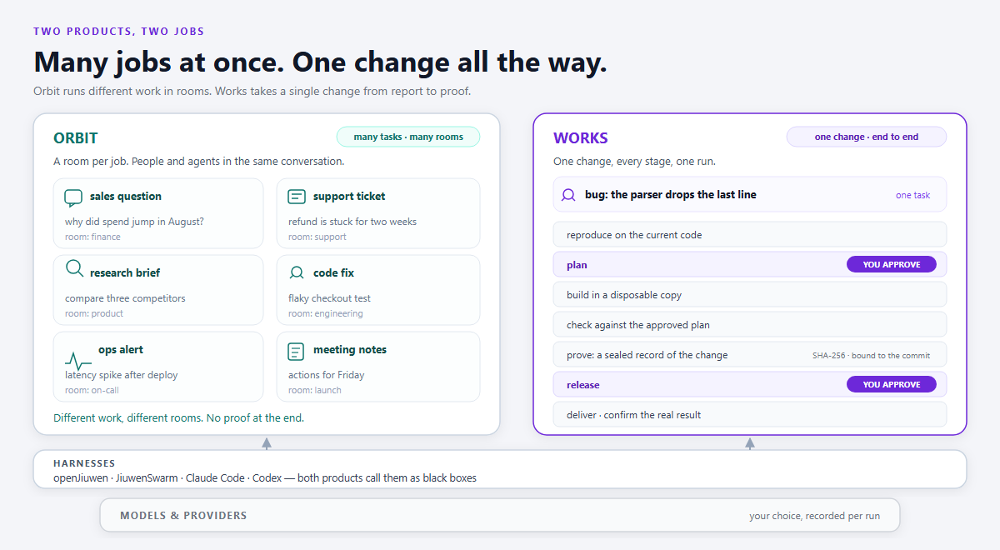
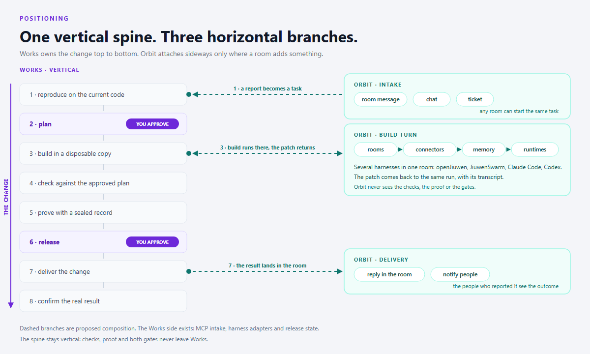
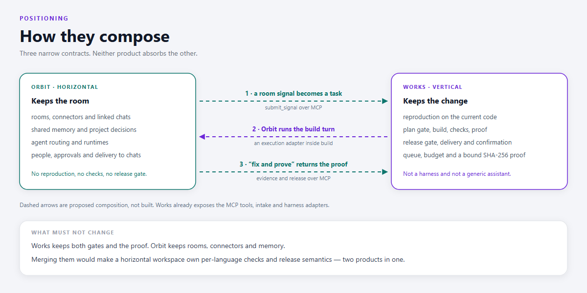
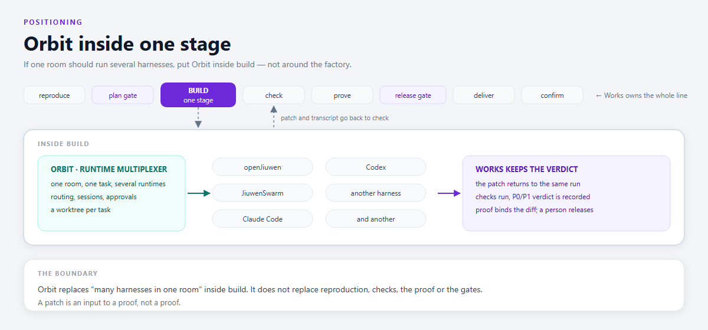

# Positioning: where Works sits, and why it is not a harness

> **Doc status:** active · **Owner:** Michael · **Last reviewed:** 2026-11-27

Status: internal note for the Creative Apps team. Not a README page and not a public claim.

## One line

**Harnesses run a turn. Orbit organises work. Works proves a change.**

## The layers

| Layer | Who owns it | What it is | Examples |
|---|---|---|---|
| Models | LLMs team | The model and the provider | any supported provider |
| Harnesses | Harnesses team | One agent turn with tools | openJiuwen, JiuwenSwarm |
| Horizontal apps | Creative Apps | Many tasks, any kind of work, people and agents in one place | Orbit |
| Vertical apps | Creative Apps | One lifecycle, one kind of change, one proof | Works |

Works and Orbit both sit above harnesses. They are not above each other.

## Two axes, not two sizes

**Orbit is horizontal.** Its unit is a room and a task: rooms, connectors, shared memory, routing,
agent runtimes, approvals inside a conversation. It is deliberately generic — it must work for
sales, support, research and code in the same product.

**Works is vertical.** Its unit is one change: reproduce on the current code, approve a plan, build
in a disposable copy, run the approved checks, write a proof bound to the exact commit, approve the
release, deliver and confirm. It is deliberately narrow — it only does software changes, and it only
does them one way.

This is why "Orbit should absorb the factory" fails on scope, not on quality: a horizontal product
would have to own per-language check contracts, worktree lifecycle, evidence schema and hashes,
release and delivery semantics, and a change queue with budgets — and keep all of it generic for
every room.

## Where Orbit attaches to the spine

The spine is the change. Orbit only attaches where a room adds something:

- **intake** ? a report in a room becomes a task;
- **build** ? one room can run several harnesses, and the patch returns to the same run;
- **delivery** ? the confirmed result lands back with the people who reported it.

Checks, the proof and both gates have no horizontal branch. They stay vertical.

## How they compose

Three narrow contracts, in both directions:

1. **A room signal becomes a task.** Orbit sends the report through Works intake (`submit_signal`
   over MCP); the Works side of this contract already exists.
2. **Orbit runs the build turn.** Works treats Orbit like any other execution adapter inside
   `build`; the patch comes back to the same run for checks.
3. **"Fix and prove" is a tool.** An agent in Orbit calls Works, gets the proof and the release
   state back into the room (`evidence`, `release` over MCP).

None of these require merging the products. Two of the three already have a built side in Works;
the Orbit side is proposed, not built.

## Orbit inside one stage, if needed

If one room should run several harnesses, that is a build-stage concern. Orbit can multiplex
openJiuwen, JiuwenSwarm, Claude Code and Codex there. The result is still a patch and a transcript
that return to Works: checks, the P0/P1 verdict, the proof and both human gates stay with Works.

A patch is an input to a proof, not a proof.

## The three claims, checked

| Claim | Verdict | Why |
|---|---|---|
| "Works is a harness." | **Wrong** | The harness contract is two methods, `propose` and `challenge`. Works has no model, no agent loop and no tool runtime; it has a queue, policy, gates, evidence, delivery and confirmation. Remove the harness and the factory still has its product; remove the pipeline and nothing is left. |
| "Orbit is a sibling app above harnesses." | **Partly** | Same broad layer, different axis. Orbit also implements its own runtime protocol and ships about three dozen task tools, so by "harness-ness" it is closer to the Harness team than Works is. |
| "Orbit is an extended builder and should own the factory." | **Wrong as a role** | Orbit can dispatch coding agents and isolate worktrees, but it has no reproduction stage, no plan gate, no check contract, no verdict rule, no bound proof, no release gate. Its "evidence" is source-revision evidence for a briefing, not a proof of a fix. |
| "The factory can use Orbit as one of its stages." | **Partly** | As intake, yes. As an execution adapter inside `build`, yes. As a replacement for a stage of the lifecycle, no. |

## How to say it in a meeting

- "Works is not competing with the Harness team; it consumes harnesses through a two-method
  contract."
- "Works is not competing with Orbit; it is the vertical app Orbit can call when the work is a
  software change."
- "Orbit is the front door and the room. Works is the control plane for the change."
- "If we merge them, Orbit stops being generic and Works stops being strict."
- "The integration is three narrow contracts, not one roadmap."

Questions to expect, and the short answers:

- **"But Orbit already runs Claude and Codex."** Yes — that is the build turn. The proof is what
  happens after the patch.
- **"Orbit already has tasks and evidence."** It has tasks and source evidence for a briefing. It
  does not bind a diff, checks, a verdict and a release to one hash.
- **"Why not one product?"** Because one product would have to be both generic and strict at the
  same time. The MCP boundary gives one front door with two engines.
- **"Who owns what?"** Harnesses own the turn, Creative Apps owns both apps, Works owns the change
  lifecycle, Orbit owns the room.

## What exists and what is proposed

| Piece | State |
|---|---|
| Works harness contract (`propose`, `challenge`) and adapters for openJiuwen and JiuwenSwarm | built |
| Works MCP tools: `submit_signal`, `list_tasks`, `task`, `evidence`, `release` | built |
| Works intake from GitHub, Jira, a monitor and a person | built |
| Orbit rooms, connectors, memory, routing and runtimes | built, in Orbit |
| Orbit calling Works over MCP | proposed |
| Orbit as a Works build adapter | proposed |
| Works accepting a signal from an Orbit room | proposed |

Do not draw the proposed links as solid in public material.

## Signs the story is drifting

- Someone describes Works as "an agent that fixes bugs" — it is a pipeline around agents.
- Someone proposes putting the queue and the gates into Orbit — that is the merge in disguise.
- Someone asks which harness Works "is" — the answer is none.
- A diagram shows Orbit under Works or Works under Orbit — they are side by side.

## Related

- `docs/roadmap/archive/2026-modern-plan.md` — the completed modernization plan.
- `docs/roadmap/archive/milestones/m23-decision-support.md` — the decision-support design record.
- `docs/reference/lifecycle/proof.md` — what a proof actually binds.
